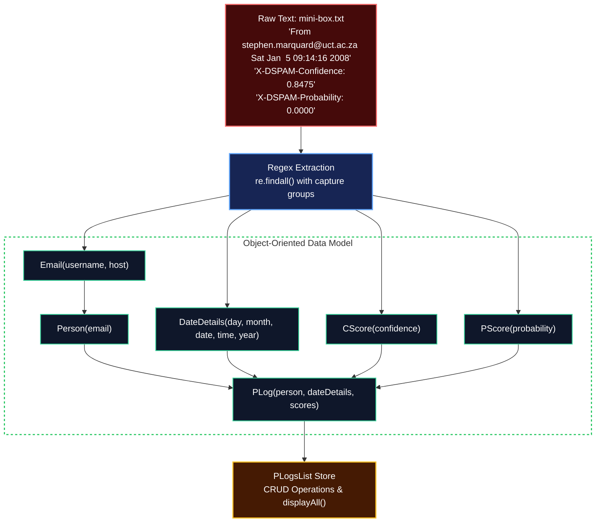

# Step-by-Step Guide: Building the Structured Mail Log Parser 🛠️

> **Target File:** [`Source Code/Project/code.py`](Source%20Code/Project/code.py)  
> **Input Dataset:** [`Source Code/Project/mini-box.txt`](Source%20Code/Project/mini-box.txt)  
> **Key Objective:** Transform raw server log text into structured, strongly-typed Python objects using regular expressions and Object-Oriented Programming (OOP).

---

## 🎯 Architecture Diagram



---

## 🪜 Step-by-Step Implementation

### Step 1: Define the Domain Model
We avoid using raw nested dictionaries because in production agent systems, structured dataclasses or OOP models provide type hints, validation, and self-documenting code.

1. **`Email`:** Separates username and host.
   ```python
   class Email:
       def __init__(self, host: str, username: str):
           self.host = host
           self.username = username
   ```
2. **`Score` Hierarchy:** Demonstrates polymorphism with `CScore` (Confidence) and `PScore` (Probability):
   ```python
   class Score:
       def __init__(self, score: str):
           self.score = score

   class CScore(Score):
       def __init__(self, score: str):
           super().__init__(score)
           self.type = "Confidence-Score"

   class PScore(Score):
       def __init__(self, score: str):
           super().__init__(score)
           self.type = "Probability-Score"
   ```
3. **`Person` and `DateDetails`:**
   ```python
   class Person:
       def __init__(self, email: Email):
           self.mail = email

   class DateDetails:
       def __init__(self, day, month, date, time, year):
           self.day = day
           self.month = month
           self.date = date
           self.time = time
           self.year = year
   ```
4. **`PLog` and `PLogsList`:**
   The aggregate container and repository managing logs with filtering and deletion:
   ```python
   class PLog:
       def __init__(self, person: Person, dateDetails: DateDetails, scores=None):
           self.person = person
           self.dateDetails = dateDetails
           self.scores = scores if scores is not None else []

   class PLogsList:
       def __init__(self):
           self.logs = []

       def create(self, log: PLog):
           self.logs.append(log)

       def readByPerson(self, username: str):
           return [x for x in self.logs if x.person.mail.username == username]

       def delete(self, username: str):
           self.logs = [x for x in self.logs if x.person.mail.username != username]
           return True

       def displayAll(self):
           for x in self.logs:
               print(f"User: {x.person.mail.username}@{x.person.mail.host} | Time: {x.dateDetails.time} | Score: {x.scores[0].score}")
   ```

---

### Step 2: Formulate the Regular Expressions

Analyze the target lines in `mini-box.txt`:
```text
From stephen.marquard@uct.ac.za Sat Jan  5 09:14:16 2008
X-DSPAM-Confidence: 0.8475
X-DSPAM-Probability: 0.0000
```

1. **Matching the `From` Header:**
   - Pattern: `r'^From\s+(\S+)@(\S+)\s+(\w+)\s+(\w+)\s+(\d{1,2})\s+(\d{2}:\d{2}:\d{2})\s+(\d{4})'`
   - Breakdown:
     - `^From\s+`: Starts with `From` followed by one or more spaces.
     - `(\S+)@(\S+)`: Group 1 is username, Group 2 is host domain.
     - `\s+(\w+)`: Group 3 is 3-letter weekday (e.g. `Sat`).
     - `\s+(\w+)`: Group 4 is 3-letter month (e.g. `Jan`).
     - `\s+(\d{1,2})`: Group 5 is day of month (1 or 2 digits).
     - `\s+(\d{2}:\d{2}:\d{2})`: Group 6 is HH:MM:SS timestamp.
     - `\s+(\d{4})`: Group 7 is 4-digit year.

2. **Matching DSPAM Scores:**
   - Confidence: `r'^X-DSPAM-Confidence: (\d+\.?\d*)'`
   - Probability: `r'^X-DSPAM-Probability: (\d+\.?\d*)'`

---

### Step 3: Stream, Parse, and Populate Objects

Iterate through the file line by line to maintain state between multi-line records:

```python
with open("mini-box.txt", "r") as logsFile:
    content = logsFile.read()

logs = PLogsList()
gEmail = None
gDateDetails = None
gConfidence = None
gProbability = None

for line in content.splitlines():
    if re.search(r'^From', line):
        data = re.findall(
            r'^From\s+(\S+)@(\S+)\s+(\w+)\s+(\w+)\s+(\d{1,2})\s+(\d{2}:\d{2}:\d{2})\s+(\d{4})',
            line
        )
        if data:
            username, host, day, month, date, time, year = data[0]
            gEmail = Email(host, username)
            gDateDetails = DateDetails(day, month, date, time, year)

    elif re.search('^X-DSPAM-Confidence: ', line):
        data = re.findall(r'^X-DSPAM-Confidence: (\d+\.?\d*)', line)
        if data:
            gConfidence = CScore(data[0])

    elif re.search('^X-DSPAM-Probability: ', line):
        data = re.findall(r'^X-DSPAM-Probability: (\d+\.?\d*)', line)
        if data:
            gProbability = PScore(data[0])

    else:
        # End of record block: construct entity
        if gEmail and gDateDetails and gConfidence and gProbability:
            person = Person(gEmail)
            log = PLog(person, gDateDetails, [gConfidence, gProbability])
            logs.create(log)
            # Reset temporary state
            gEmail = gDateDetails = gConfidence = gProbability = None

logs.displayAll()
```

---

## 💡 Key Agentic Takeaways

1. **Stateful Streaming Parsing:** When LLMs stream chunks of Markdown, XML, or JSON, text arrives asynchronously in fragments. Stateful line-by-line parsing mimics how agent event-listeners process streaming thought loops.
2. **Polymorphic Containers:** Separating `CScore` and `PScore` under `Score` allows downstream agent tools to process arbitrary metrics without altering the core pipeline.
3. **Regex Robustness:** Always guard against optional components (e.g. `\d{1,2}` for single vs double digit days, `\d+\.?\d*` for integers and floats).
