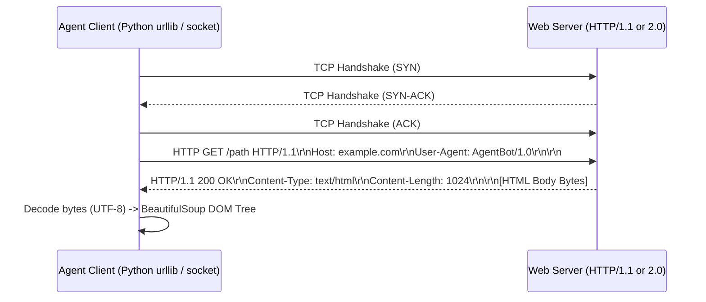

# Chapter 2: Network Programming for Agentic AI 🌐

> **Roadmap Alignment:** Days 3–4 (Ch 12: Networked Programs & Parsing HTML)  
> **Primary Goals:** Master TCP/IP sockets, the HTTP request/response lifecycle, header inspection, `urllib.request` streaming, and HTML DOM parsing with `BeautifulSoup4`.

---

## 🧠 Why Network Programming is Critical in Agentic AI

Autonomous agents are rarely isolated; they live on the web. An AI Agent acts as an active web participant:
1. **Tool-Driven Web Search:** When an agent answers questions with real-time knowledge, it issues HTTP GET requests to search engines or documentation hubs.
2. **Web Scraping & RAG Ingestion:** Agents fetch raw HTML, strip boilerplates (scripts, styles, navigations), and parse relevant paragraphs for vector embeddings.
3. **Deep Link Traversal:** Multi-step autonomous researchers (like LinkAtlas or LangGraph research nodes) traverse websites recursively to gather citations and verify facts.
4. **Header & Protocol Inspection:** Autonomous agents must inspect HTTP response headers to respect rate limits (`Retry-After`), detect encoding (`Content-Type: charset=utf-8`), and avoid blocking IP addresses.

---

## 📚 Core Network Concepts



### 1. Low-Level Sockets vs High-Level `urllib`
- **Sockets (`socket` module):** Raw bidirectional byte streams over TCP port 80/443. Teaches the literal newline protocol (`\r\n\r\n`) separating HTTP headers from body payload.
- **`urllib.request`:** High-level Python standard library abstraction handling DNS resolution, connection pooling, redirection, and SSL/TLS handshakes.

### 2. HTML DOM Parsing with `BeautifulSoup4`
- Raw HTML strings are noisy and unstructured.
- `BeautifulSoup` converts raw markup into an navigable parse tree, allowing an agent to extract elements by tag (`soup.find_all('a')`), CSS class (`soup.select('.price')`), or HTML attributes (`link.get('href')`).

---

## 📖 Dr. Chuck's Official Study Resources

Review Dr. Chuck's network programming slides and reference sheets located in [`Content/`](Content):
- 📄 [**Pythonlearn-12-HTTP.pdf**](Content/Dr.%20Chuck/Pythonlearn-12-HTTP.pdf) — Complete lecture slide deck on Networked Programs, Sockets, and HTTP.
- 📊 [**Pythonlearn-12-HTTP.pptx**](Content/Dr.%20Chuck/Pythonlearn-12-HTTP.pptx) — Original PowerPoint presentation deck.
- 📓 [**Notes.md**](Content/Notes.md) & [**Notes.pdf**](Content/Notes.pdf) — Comprehensive notes on network architecture and sockets.
- 📑 [**Paper Sheet.pdf**](Paper%20Sheet.pdf) — Quick protocol and command reference sheet.

---

## 📂 Chapter Contents & Structure

```text
C2 # Network Programming/
├── Content/
│   ├── Notes.md                     <-- Comprehensive lecture notes & socket breakdown
│   ├── Notes.pdf                    <-- Slide notes
│   └── Dr. Chuck/                   <-- Dr. Chuck's lecture slides (PDF & PPTX)
│       ├── Pythonlearn-12-HTTP.pdf
│       └── Pythonlearn-12-HTTP.pptx
├── Paper Sheet.pdf                  <-- Quick reference sheet
├── Worked Examples/
│   ├── 1- Fetch Text File.py        <-- Reading raw remote text line by line
│   ├── 2- Word Frequency Counter.py <-- Streaming remote file into a word dictionary
│   ├── 3- Email with most mails.py  <-- Regex + remote stream email aggregator
│   ├── 4- Shakespear Text.py        <-- Analyzing full remote literature files
│   └── 5- Read CSV File.py          <-- Consuming remote tabular CSV data
├── Final Task/
│   ├── m0-d03-url-fetcher.py        <-- Inspecting headers & saving web response
│   └── m0-d04-link-extractor.py     <-- BeautifulSoup DOM link scraper
├── README.md                        <-- You are here (Chapter Overview)
└── STEP_BY_STEP_GUIDE.md            <-- Step-by-step build guide for the Final Tasks
```

---

## 🏃 Worked Examples Overview

- **`1- Fetch Text File.py`:** Uses `urllib.request.urlopen()` as an iterable file handle, reading remote lines without loading entire files into memory.
- **`2- Word Frequency Counter.py`:** Streams `romeo.txt`, decodes UTF-8 lines, counts word frequencies using dictionary `.get(w, 0) + 1`, and extracts top 5 words via `sorted()`.
- **`3- Email with most mails.py`:** Streams mbox mail logs over HTTP, applies regex pattern matching on `^From: `, and tracks the most active sender.
- **`5- Read CSV File.py`:** Streams remote CSV files and parses columns directly into structured data.

---

## 🎯 Final Tasks & Commit Targets

1. **Day 3 Task (`m0-d03-url-fetcher.py`):**
   - Fetches webpage headers and body from any remote URL.
   - Extracts response headers (`Content-Type`, `Date`, `Server`) and formats them cleanly.
   - Saves structured output to `output.txt`.

2. **Day 4 Task (`m0-d04-link-extractor.py`):**
   - Connects to `books.toscrape.com`.
   - Uses `BeautifulSoup4` to parse the HTML DOM.
   - Discovers all anchor tags `<a>` and extracts metadata (`title`, `href`).

👉 For step-by-step instructions on implementing and expanding these tools into production-ready agent modules, see [**STEP_BY_STEP_GUIDE.md**](STEP_BY_STEP_GUIDE.md).
