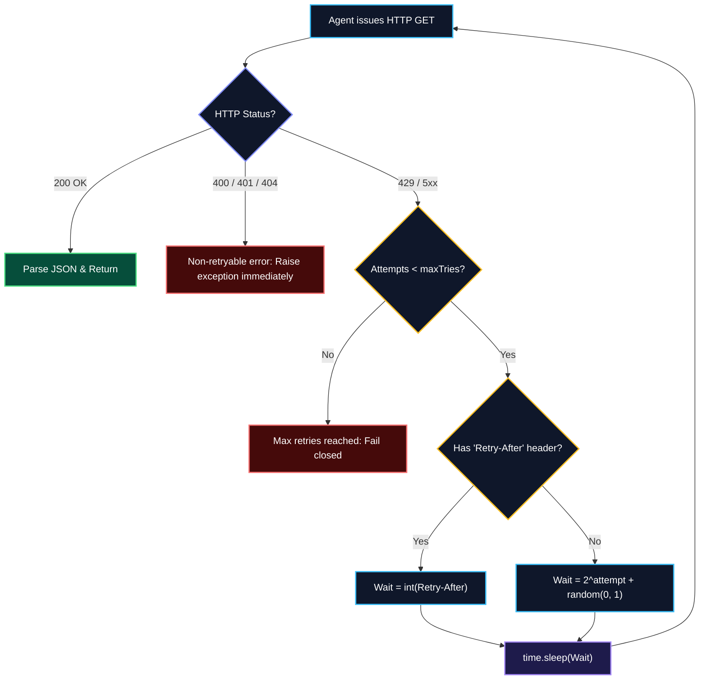

# Chapter 3: Web Services & APIs for Agentic AI ⚡

> **Roadmap Alignment:** Days 5–6 (Ch 13: XML & JSON + API Security & Rate Limiting)  
> **Primary Goals:** Master data serialization (XML vs. JSON), REST API consumption, authentication headers, HTTP status code semantics, rate limits, and resilient exponential backoff with jitter.

---

## 🧠 Why Web Services are Critical in Agentic AI

Modern autonomous agents do not operate in a vacuum. Whenever an LLM calls a tool—such as searching Google, booking a flight, checking stock prices, or querying GitHub—it interacts with a **REST Web Service**.

However, public and enterprise APIs present major production challenges:
1. **Strict Rate Limiting (HTTP 429):** Agents making rapid sequential requests get throttled. Without backoff logic, the entire workflow crashes.
2. **Transient Failures (HTTP 500/502/503):** Remote endpoints frequently drop packets or restart.
3. **Data Serialization:** LLMs natively think in JSON schemas; agents must validate inbound JSON before passing arguments into downstream functions.
4. **Security & Secrets:** API keys and Bearer tokens must be passed via secure headers and never leaked into logs or prompts.

---

## 📊 XML vs. JSON Comparison for Agent Systems

| Feature | XML (`xml.etree.ElementTree`) | JSON (`json` module) | Agentic Preference |
|---|---|---|---|
| **Syntax** | Verbose tags (`<item>value</item>`) | Key-value pairs (`{"item": "value"}`) | **JSON** (lower token cost) |
| **Parsing Overhead** | High (Tree traversal, attributes) | Low (Direct mapping to `dict`/`list`) | **JSON** (faster serialization) |
| **Schema Validation** | XSD (Complex) | JSON Schema / Pydantic | **JSON** (LLM-native) |
| **Legacy Systems** | Enterprise SOAP, RSS feeds, MusicXML | Modern REST, GraphQL, LLM Tool Calling | Depends on target tool |

---

## 📖 Dr. Chuck's Official Study Resources

Review Dr. Chuck's web services lecture presentations located in [`Content/Dr Chuck/`](Content/Dr%20Chuck):
- 📄 [**Pythonlearn-13-WebServices.pdf**](Content/Dr%20Chuck/Pythonlearn-13-WebServices.pdf) — Complete lecture slide deck on XML, JSON, and Web Services APIs.
- 📊 [**Pythonlearn-13-WebServices.pptx**](Content/Dr%20Chuck/Pythonlearn-13-WebServices.pptx) — Original PowerPoint presentation deck.

---

## 📂 Chapter Contents & Structure

```text
C3 # Web Services/
├── Content/
│   └── Dr Chuck/                    <-- Dr. Chuck's lecture slides (PDF & PPTX)
│       ├── Pythonlearn-13-WebServices.pdf
│       └── Pythonlearn-13-WebServices.pptx
├── Tasks/
│   ├── .env                         <-- Environment variables (API keys)
│   ├── m0-d05-api client.py         <-- Day 5: Weather API fetcher with error handling
│   └── m0-d06-robust api.py         <-- Day 6: Robust client with exponential backoff & jitter
├── Worked Examples/
│   ├── json1.py                     <-- Basic JSON parsing and dictionary navigation
│   ├── xml1.py                      <-- XML parsing with xml.etree.ElementTree
│   └── opengeo.py                   <-- Geocoding REST API consumer
├── README.md                        <-- You are here (Chapter Overview)
└── STEP_BY_STEP_GUIDE.md            <-- Step-by-step implementation guide
```

---

## 🛡️ The Exponential Backoff with Jitter Algorithm

When a service responds with `HTTP 429 Too Many Requests` or `HTTP 503 Service Unavailable`, an immediate retry will fail and exacerbate server load.

Instead, we apply **Full Jitter Exponential Backoff**:

$$\text{Wait Time} = 2^{\text{attempt}} + \text{uniform}(0, 1)$$



---

## 🎯 Final Tasks & Commit Targets

1. **Day 5 Task (`m0-d05-api client.py`):**
   - Connects to the Open-Meteo REST API (`https://api.open-meteo.com/v1/forecast`).
   - Uses `urllib.parse.urlencode()` to formulate URL query parameters cleanly.
   - Parses the JSON response and formats it with `json.dumps(info, indent=4)`.

2. **Day 6 Task (`m0-d06-robust api.py`):**
   - Encapsulates network operations inside a reusable `APIClient` class.
   - Supports Bearer token authorization headers.
   - Handles `HTTPError` 429 and 500-599.
   - Honors `Retry-After` header when provided, otherwise computes exponential backoff with randomized jitter.

👉 For step-by-step instructions on implementing this robust API client, see [**STEP_BY_STEP_GUIDE.md**](STEP_BY_STEP_GUIDE.md).
