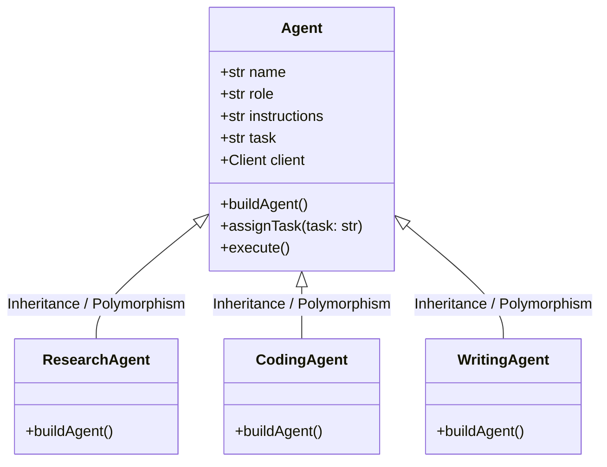

# Chapter 4: Object-Oriented Programming (OOP) for AI Agents 🧱

> **Roadmap Alignment:** Day 7 (Ch 14: Object-Oriented Programming)  
> **Primary Goals:** Master classes, objects, encapsulation, inheritance, polymorphism, and stateful lifecycle execution by building an extensible `BaseAgent` hierarchy.

---

## 🧠 Why OOP is the Foundation of Agent Architectures

In production AI systems (such as LangChain, CrewAI, AutoGen, and Semantic Kernel), every agent is an instance of an Object-Oriented class.



### Key OOP Principles in Agent Systems:
1. **Encapsulation:** The agent encapsulates its private prompt persona, memory history, and API client credentials away from the orchestrator.
2. **Inheritance:** Common agent infrastructure (API calling, task assignment, token tracking, error logging) is defined once in `BaseAgent` and inherited by all specialist sub-agents.
3. **Polymorphism:** The orchestrator can invoke `.execute()` on any list of agents `[Agent1, Agent2, Agent3]` without knowing whether the underlying agent is a Coder, Researcher, or Critic. Each specialist implements its behavior accordingly.

---

## 📖 Dr. Chuck's Official Study Resources

Review Dr. Chuck's object-oriented programming lecture presentations located in [`Content/Dr Chuck/`](Content/Dr%20Chuck):
- 📄 [**Pythonlearn-14-Objects.pdf**](Content/Dr%20Chuck/Pythonlearn-14-Objects.pdf) — Complete lecture slide deck on Object-Oriented Programming, Classes, and Inheritance.
- 📊 [**Pythonlearn-14-Objects.pptx**](Content/Dr%20Chuck/Pythonlearn-14-Objects.pptx) — Original PowerPoint presentation deck.

---

## 📂 Chapter Contents & Structure

```text
C4 # OOP/
├── Content/
│   └── Dr Chuck/                    <-- Dr. Chuck's lecture slides (PDF & PPTX)
│       ├── Pythonlearn-14-Objects.pdf
│       └── Pythonlearn-14-Objects.pptx
├── Deliverable/
│   ├── m0-d07-oop agent.py         <-- Day 7: BaseAgent, Specialist subclasses & Gemini API
│   └── Agents Results/             <-- Artifacts generated by the agents
│       ├── Coding Agent/           <-- C++ snake game, Python snake game, prompts
│       ├── Research Agent/         <-- IEEE-style markdown research papers
│       └── Writing Agent/          <-- Narrative dialogues & articles
├── README.md                       <-- You are here (Chapter Overview)
└── STEP_BY_STEP_GUIDE.md           <-- Step-by-step build guide for the Agent Hierarchy
```

---

## 👥 Specialist Agent Profiles

1. **Researcher Agent (`ResearchAgent`):**
   - **Persona:** Academic researcher with 20 years of domain investigation.
   - **Constraint:** Strictly follows IEEE formatting, includes citations, outputs **only** pure Markdown with zero conversational preamble.

2. **Developer Agent (`CodingAgent`):**
   - **Persona:** Senior software engineer specializing in Gang of Four (GoF) design patterns and robust debugging.
   - **Constraint:** Outputs **only** runnable, commented code blocks with zero conversational greetings.

3. **Writer Agent (`WritingAgent`):**
   - **Persona:** Veteran creative writer and essayist.
   - **Constraint:** Adaptive tone, strict word limit governance (default 350 words), zero conversational filler.

---

## 🎯 Deliverable Overview

The deliverable in [`Deliverable/m0-d07-oop agent.py`](Deliverable/m0-d07-oop%20agent.py) demonstrates how an OOP abstraction runs three diverse specialists in sequence, producing tangible code, research, and creative outputs.

👉 For complete instructions on building, customizing, and scaling this agent hierarchy, read [**STEP_BY_STEP_GUIDE.md**](STEP_BY_STEP_GUIDE.md).
