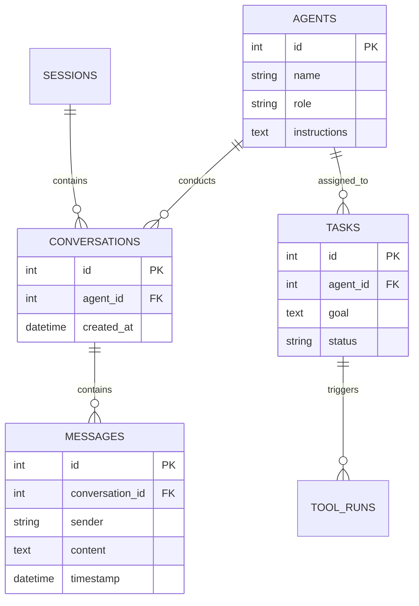

# Chapter 5: Databases & Agent Memory Stores 🗄️

> **Roadmap Alignment:** Days 8–9 (Ch 15: Databases with SQLite/MySQL & Advanced SQL)  
> **Primary Goals:** Master relational database design (DDL/DML), schema normalization, foreign keys, many-to-many relationship modeling, and persistent multi-turn conversational agent memory.

---

## 🧠 Why Databases are Critical in Agentic AI

LLMs are inherently **stateless**. Every HTTP call to an LLM is completely isolated—the model remembers nothing from previous queries unless past context is re-injected.

In production Agentic AI, **Databases form the Long-Term Memory (LTM) Architecture**:
1. **Conversation History:** Storing user messages and agent replies across different sessions.
2. **Task State & Recovery:** Persisting agent planning states so that if an agent crashes or network drops, it can resume without restarting.
3. **Audit Trails & Observability:** Recording token counts, latencies, tool execution inputs, and verifier verdicts.
4. **Relational Context:** Modeling many-to-many relationships between agents, roles, tools, and conversations.

---

## 📊 Relational Database Architecture for Agents



---

## 📖 Dr. Chuck's Official Study Resources

Review Dr. Chuck's database and SQL lecture presentations located in [`Content/Dr Chuck/`](Content/Dr%20Chuck):
- 📄 [**Pythonlearn-15-Databases.pdf**](Content/Dr%20Chuck/Pythonlearn-15-Databases.pdf) — Complete lecture slide deck on Databases, SQLite, SQL, and Many-to-Many Relationships.
- 📊 [**Pythonlearn-15-Databases.pptx**](Content/Dr%20Chuck/Pythonlearn-15-Databases.pptx) — Original PowerPoint presentation deck.

---

## 📂 Chapter Contents & Structure

```text
C5 # Databases/
├── Content/
│   └── Dr Chuck/                    <-- Dr. Chuck's lecture slides (PDF & PPTX)
│       ├── Pythonlearn-15-Databases.pdf
│       └── Pythonlearn-15-Databases.pptx
├── Deliverable/
│   ├── chat.py                      <-- Interactive CLI multi-agent system with persistent memory
│   └── m0-d08-mysqlcrud.py          <-- Reusable relational CRUD abstraction
├── worked Example/
│   ├── mail/                        <-- Counting email domains from mbox into DB
│   │   ├── mbox-text.txt
│   │   └── mysqlcrud.py
│   ├── roster-project/              <-- Many-to-many (User - Course - Member) modeling
│   │   ├── roster.py
│   │   ├── roster_data_sample.json
│   │   └── test.js
│   └── tracks-project/              <-- Normalized audio library (Artist, Album, Track, Genre)
│       ├── tracks.csv
│       └── tracks-project.py
├── README.md                        <-- You are here (Chapter Overview)
└── STEP_BY_STEP_GUIDE.md            <-- Step-by-step build guide for the persistent chat system
```

---

## 🏃 Worked Examples Deep-Dive

1. **`mail/` (Aggregation & Counting):**
   Reads raw server logs and performs upsert operations (`INSERT INTO Counts (org, count) VALUES (?, 1) ON DUPLICATE KEY UPDATE count = count + 1`) to calculate domain frequencies efficiently.
2. **`tracks-project/` (Normalization & Foreign Keys):**
   Demonstrates 3rd Normal Form (3NF). Normalizes `Artist` -> `Album` -> `Track` -> `Genre` using foreign key references to eliminate data duplication.
3. **`roster-project/` (Many-to-Many Relationships):**
   Models complex many-to-many mappings (Students enrolled in multiple Courses) using a junction table (`Member` with composite keys `user_id`, `course_id`, and `role`).

---

## 🎯 Deliverable Overview: Interactive Persistent Chat (`chat.py`)

Located in [`Deliverable/chat.py`](Deliverable/chat.py).

Features:
- Connects to relational database storage (MySQL/SQLite).
- Manages an agent directory (`ResearchAgent`, `CodingAgent`, `WritingAgent`).
- Allows real-time switching between agents in the terminal.
- Preserves every task, prompt, and LLM response in relational tables.

👉 To learn how to build and configure this persistent database layer, read [**STEP_BY_STEP_GUIDE.md**](STEP_BY_STEP_GUIDE.md).
