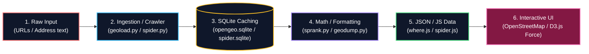

# Chapter 6: Data Visualization & Graph Topologies for AI 📊

> **Roadmap Alignment:** Day 10 (Ch 16: Data Visualization)  
> **Primary Goals:** Master data serialization for UI, interactive geographic mapping (OpenLayers / OpenStreetMap), PageRank network analysis, and D3.js force-directed graph visualization.

---

## 🧠 Why Data & Graph Visualization is Critical in Agentic AI

Modern Agentic AI architectures are **directed graphs**:
1. **LangGraph State Graphs:** In LangGraph, workflows are defined as nodes (agents/tools) and directed edges (conditional routing). Visualizing execution graphs allows engineers to identify routing bottlenecks, dead ends, and cyclic infinite loops.
2. **PageRank in RAG & Knowledge Graphs:** Before vector search, Google's PageRank algorithm established how information flows through directed link networks. In Agentic RAG, graph centrality identifies high-authority source documents.
3. **Multi-Agent Swarm Topologies:** When 10 agents collaborate, tracking who messages whom requires network node-link diagrams.
4. **Agent Observability Dashboards:** Transforming database memory into visual metrics (response latency, token burn, failure rates) is required for production operations.

---

## 🗺️ Architectural Pipeline: From Raw Data to Browser Visualization



---

## 📖 Dr. Chuck's Official Study Resources

Review Dr. Chuck's data visualization lecture presentations located in [`Content/Dr Chuck/`](Content/Dr%20Chuck):
- 📄 [**Pythonlearn-16-Data-Viz.pdf**](Content/Dr%20Chuck/Pythonlearn-16-Data-Viz.pdf) — Complete lecture slide deck on Data Visualization, Geocoding, PageRank, and D3.js.
- 📊 [**Pythonlearn-16-Data-Viz.pptx**](Content/Dr%20Chuck/Pythonlearn-16-Data-Viz.pptx) — Original PowerPoint presentation deck.

---

## 📂 Chapter Contents & Structure

```text
C6 # Data Visualization/
├── Content/
│   └── Dr Chuck/                    <-- Dr. Chuck's lecture slides (PDF & PPTX)
│       ├── Pythonlearn-16-Data-Viz.pdf
│       └── Pythonlearn-16-Data-Viz.pptx
├── Worked Examples/
│   ├── opengeo/                     <-- Geographic Mapping Pipeline
│   │   ├── geoload.py               <-- Fetches coordinates from Nominatim API & caches in SQLite
│   │   ├── geodump.py               <-- Reads SQLite & formats into JavaScript array (where.js)
│   │   ├── opengeo.sqlite           <-- Local SQLite cache of geocoded coordinates
│   │   ├── where.data               <-- Raw university text entries
│   │   ├── where.html               <-- OpenLayers interactive map visualizer
│   │   ├── where.js                 <-- Serialized geographic coordinates
│   │   └── README.md                <-- OpenGeo walkthrough
│   │
│   └── pagerank/                    <-- Web Crawler & Network Graph Visualization
│       ├── spider.py                <-- Crawls web pages and records edges in spider.sqlite
│       ├── spdump.py                <-- Dumps link counts and connectivity
│       ├── sprank.py                <-- Computes iterative PageRank authority scores
│       ├── spjson.py                <-- Exports top-ranked nodes/edges to spider.js
│       ├── force.html               <-- D3.js force-directed graph UI
│       ├── force.js                 <-- D3 interactive physics simulation
│       └── force.css                <-- Graph node/edge styling
├── README.md                        <-- You are here (Chapter Overview)
└── STEP_BY_STEP_GUIDE.md            <-- Step-by-step pipeline execution & adaptation guide
```

---

## 🧪 The Two Production Pipelines

### 1. OpenGeo Geographic Map
- **Problem:** Plot hundreds of university campus locations worldwide without overwhelming public geocoding APIs.
- **Solution:** `geoload.py` uses SQLite as a rate-limiting cache. It only queries the remote OpenStreetMap Nominatim service for addresses not yet in the database. `geodump.py` extracts the latitudes and longitudes into `where.js`, and `where.html` displays them over interactive map tiles.

### 2. PageRank & D3.js Network Graph
- **Problem:** How do autonomous web spiders understand web structure and prioritize high-value pages?
- **Solution:**
  - `spider.py` crawls links and builds an adjacency matrix in SQLite.
  - `sprank.py` simulates random page transitions to calculate PageRank vector scores.
  - `spjson.py` finds the highest-authority hubs and serializes nodes and edges.
  - `force.html` renders a live, physics-based D3 graph where high-ranking nodes pull clusters together.

👉 For step-by-step instructions on running and repurposing these visualization pipelines for agent workflows, see [**STEP_BY_STEP_GUIDE.md**](STEP_BY_STEP_GUIDE.md).
