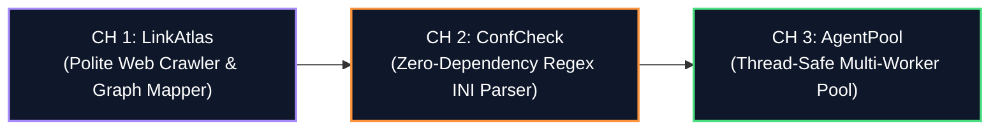

# Challenges Hub (CH 1 – CH 3) 🏆

> **Roadmap Phase:** Days 17–19 (Challenges Phase)  
> **Philosophy:** High-constraint software engineering challenges. No high-level abstractions, zero shortcuts. These challenges develop the architectural instincts required to engineer robust autonomous systems.

---

## 🧭 Overview & Progression

---

## 📊 Challenges Comparison Matrix

| Challenge | Location | Day | Key Engineering Constraints | Real-World Utility |
|---|---|---|---|---|
| **LinkAtlas** | [`CH 1 - LinkAtlas/`](CH%201%20-%20LinkAtlas) | Day 17 | BFS graph search (Depth 0, 1, 2), `robots.txt` compliance, `Crawl-delay`, GraphML / DOT / CSV serialization | Audits site-wide broken links, external outbound graphs, and maps RAG ingestion graphs. |
| **ConfCheck** | [`CH 2 - ConfCheck/`](CH%202%20-%20ConfCheck) | Day 18 | **Zero external libraries** (No `configparser`), Lexer & state machine, negative lookaheads, schema validation | Lints configuration files in CI/CD pipelines with exact line and column numbers. |
| **AgentPool** | [`CH 3 - AgentPool/`](CH%203%20-%20AgentPool) | Day 19 | 5 daemon threads, `queue.Queue` task buffering, thread-safe SQLite WAL, Poison Pill shutdown | High-throughput concurrent agent execution without deadlocks or SQLite write collisions. |

---

## 📂 Sub-Projects Overview

- 🕷️ [**CH 1: LinkAtlas**](CH%201%20-%20LinkAtlas): A polite, depth-limited recursive web crawler and network graph mapper. Implements Breadth-First Search (BFS), per-host rate limiting, `robots.txt` parsing, and directed graph exports for Gephi, NetworkX, Graphviz, and CSV.
- ⚙️ [**CH 2: ConfCheck**](CH%202%20-%20ConfCheck): A pure-regex INI configuration parser and schema linter built completely from scratch without Python's standard `configparser`. Demonstrates compiler lexing, multi-line value continuations, negative lookaheads for inline comments, and type inference.
- 🧵 [**CH 3: AgentPool**](CH%203%20-%20AgentPool): A multi-worker thread pool executing 20 tasks across 5 specialist agents with thread-safe SQLite logging, mutex locking, WAL mode, and graceful poison-pill termination.
