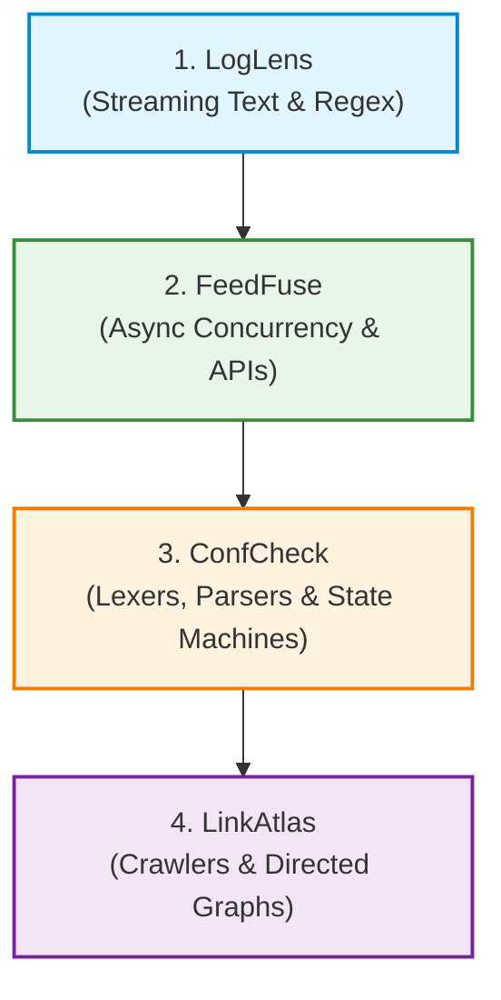

# Python Project-Based Learning Curriculum 🎓
> **Target Audience:** Anyone who has learned basic Python syntax (variables, loops, functions, lists/dictionaries) and wants to become a confident, production-grade software engineer.
> **Philosophy:** *“Don’t just learn syntax; build real tools that solve real problems.”*

---

## 🗺️ The 4-Tier Learning Roadmap

This repository features four complete, production-grade CLI tools. Each project is designed to teach a foundational pillar of computer science and Python software engineering:



---

## 1. Project Curriculum Matrix

| Project | Location | Difficulty | Core Topics Learned | Real-World Utility |
|---|---|---|---|---|
| **LogLens** | `Worked Examples\WE 1 - LogLens` | 🟢 Beginner | Generators (`yield`), Regex Named Groups `(?P<name>)`, Memory-safe file streaming, Dynamic filtering | Parse multi-GB server access logs without freezing RAM. |
| **FeedFuse** | `Practice Tasks\PT 2 - FeedFuse` | 🟡 Intermediate | `asyncio`, `httpx.AsyncClient`, Dot-notation paths, Secrets isolation (`${VAR}`), Fault tolerance | Merge multiple slow APIs concurrently without crashing if one is down. |
| **ConfCheck** | `Challenges\CH 2 - ConfCheck` | 🟠 Advanced | Compiler Lexing, Line-by-line State Machine, Type Inference, Schema Validation, CI Exit Codes | Lint config files in CI/CD with exact line numbers (Zero `configparser`). |
| **LinkAtlas** | `Challenges\CH 1 - LinkAtlas` | 🔴 Pro | Breadth-First Search (BFS), Politeness & `robots.txt`, Directed Graphs, GraphML / DOT / CSV export | Audit outbound external links and broken internal pages across an entire site. |

---

## 2. In-Depth Project Summaries & Direct Links

### 📗 Tier 1: LogLens (Regex Log Parser)
- 📂 **Project Directory:** [`Worked Examples/WE 1 - LogLens`](file:///D:/Notes/Personal/Agentic-AI/1-%20PY4E/Worked%20Examples/WE%201%20-%20LogLens)
- 📖 **Full Step-by-Step Guide:** [`WE 1 - LogLens/STEP_BY_STEP_GUIDE.md`](file:///D:/Notes/Personal/Agentic-AI/1-%20PY4E/Worked%20Examples/WE%201%20-%20LogLens/STEP_BY_STEP_GUIDE.md)
- **Why Build It?**
  Beginners often rely on `file.read()` or `file.readlines()`. When given a 5 GB server log, the machine runs out of memory and crashes. LogLens demonstrates how to stream and filter 50 GB log files within ~15 MB of RAM using Python generators (`yield`).
- **Key Concepts:**
  - `re.compile()` with named capture groups `(?P<ip>\S+)`
  - Generator functions (`yield line_no, row, raw_line`)
  - Dynamic AST and condition evaluation (`--where "status>=500"`)
  - Rich tables and CSV/JSON streaming

---

### 📘 Tier 2: FeedFuse (Concurrent API Aggregator)
- 📂 **Project Directory:** [`Practice Tasks/PT 2 - FeedFuse`](file:///D:/Notes/Personal/Agentic-AI/1-%20PY4E/Practice%20Tasks/PT%202%20-%20FeedFuse)
- 📖 **Full Step-by-Step Guide:** [`PT 2 - FeedFuse/STEP_BY_STEP_GUIDE.md`](file:///D:/Notes/Personal/Agentic-AI/1-%20PY4E/Practice%20Tasks/PT%202%20-%20FeedFuse/STEP_BY_STEP_GUIDE.md)
- **Why Build It?**
  Synchronous network requests (`requests.get`) waste time waiting for remote servers. If four APIs each take 1 second, sequential requests require 4 seconds, whereas asynchronous requests (`asyncio`) finish in just 1 second.
- **Key Concepts:**
  - `async` / `await` and `asyncio.gather(*tasks, return_exceptions=True)`
  - `httpx.AsyncClient` with connection pooling
  - Extracting nested JSON paths using dot notation (`data.weather.temperature`)
  - YAML configuration and environment variable masking (`${TOKEN}`)
  - Disk caching with TTL expiry

---

### 📙 Tier 3: ConfCheck (Regex Config Parser & Linter)
- 📂 **Project Directory:** [`Challenges/CH 2 - ConfCheck`](file:///D:/Notes/Personal/Agentic-AI/1-%20PY4E/Challenges/CH%202%20-%20ConfCheck)
- 📖 **Full Step-by-Step Guide:** [`CH 2 - ConfCheck/STEP_BY_STEP_GUIDE.md`](file:///D:/Notes/Personal/Agentic-AI/1-%20PY4E/Challenges/CH%202%20-%20ConfCheck/STEP_BY_STEP_GUIDE.md)
- **Why Build It?**
  Using libraries is simple, but building a parser from scratch with **zero external libraries** reveals how programming language interpreters, lexers, and compilers work under the hood.
- **Key Concepts:**
  - Tokenizing and lexing text purely through compiled regex patterns
  - Line-by-line State Machine (tracking section headers, key-value lines, indented continuations, backslash `\` joins)
  - Negative Lookahead regexes (`(?!\s+[;#])`) for comments vs URL hashes
  - Schema definition, type coercion (`int`, `bool`, `list`, `str`), bounds (`min`, `max`), and choices
  - CI/CD exit codes (0 for pass, 1 for lint errors, 2 for fatal crashes)

---

### 📕 Tier 4: LinkAtlas (Recursive Polite Web Crawler & Graph Mapper)
- 📂 **Project Directory:** [`Challenges/CH 1 - LinkAtlas`](file:///D:/Notes/Personal/Agentic-AI/1-%20PY4E/Challenges/CH%201%20-%20LinkAtlas)
- 📖 **Full Step-by-Step Guide:** [`CH 1 - LinkAtlas/STEP_BY_STEP_GUIDE.md`](file:///D:/Notes/Personal/Agentic-AI/1-%20PY4E/Challenges/CH%201%20-%20LinkAtlas/STEP_BY_STEP_GUIDE.md)
- **Why Build It?**
  Web scraping focuses on extracting data from a single page. Web crawling is recursive network traversal where you must balance rate limits, internet etiquette (`robots.txt`), and graph data structures.
- **Key Concepts:**
  - Breadth-First Search (BFS) using `collections.deque` with strict depth limits (Depth 0, 1, 2)
  - URL normalisation (dropping anchors, tracking query params, default ports)
  - Politeness engine: `robots.txt` caching, `Crawl-delay`, per-host sleep, `Retry-After` on 429
  - Directed Graph data model: Nodes (Pages, External URLs) and Edges (counts, anchor text, `nofollow` AND logic)
  - Multi-format serialization: JSON node-link (NetworkX / D3), GraphML (Gephi / yEd), Graphviz DOT, CSV

---

## 3. Recommended Study Routine for Beginners

If you are new to intermediate Python, follow this 4-week progression:

1. **Week 1 — LogLens:**
   - Read [`WE 1 - LogLens/STEP_BY_STEP_GUIDE.md`](file:///D:/Notes/Personal/Agentic-AI/1-%20PY4E/Worked%20Examples/WE%201%20-%20LogLens/STEP_BY_STEP_GUIDE.md).
   - Understand how `presets.py` and `parser.py` use `yield`.
   - Run: `python -m loglens sample_logs/nginx.log --preset nginx`.
2. **Week 2 — FeedFuse:**
   - Read [`PT 2 - FeedFuse/STEP_BY_STEP_GUIDE.md`](file:///D:/Notes/Personal/Agentic-AI/1-%20PY4E/Practice%20Tasks/PT%202%20-%20FeedFuse/STEP_BY_STEP_GUIDE.md).
   - Learn the event loop and `asyncio.gather()`.
   - Create your own `sources.yaml` with free APIs (weather, crypto, quotes) and aggregate them.
3. **Week 3 — ConfCheck:**
   - Read [`CH 2 - ConfCheck/STEP_BY_STEP_GUIDE.md`](file:///D:/Notes/Personal/Agentic-AI/1-%20PY4E/Challenges/CH%202%20-%20ConfCheck/STEP_BY_STEP_GUIDE.md).
   - Understand how state machines process lines and track context.
   - Run tests against broken configs to see line-numbered diagnostics.
4. **Week 4 — LinkAtlas:**
   - Read [`CH 1 - LinkAtlas/STEP_BY_STEP_GUIDE.md`](file:///D:/Notes/Personal/Agentic-AI/1-%20PY4E/Challenges/CH%201%20-%20LinkAtlas/STEP_BY_STEP_GUIDE.md).
   - Learn BFS queue traversal and `robots.txt` caching.
   - Crawl a practice site and load the generated JSON into NetworkX or Gephi.

---

## 4. Comprehensive Automated Test Suites

Each project includes a full automated test suite to teach real-world test-driven development:

```powershell
# 1. LogLens tests (34 tests)
cd "D:\Notes\Personal\Agentic-AI\1- PY4E\Worked Examples\WE 1 - LogLens"
python -m pytest -v

# 2. FeedFuse tests (40 tests)
cd "D:\Notes\Personal\Agentic-AI\1- PY4E\Practice Tasks\PT 2 - FeedFuse"
python -m pytest -v

# 3. ConfCheck tests (37 tests)
cd "D:\Notes\Personal\Agentic-AI\1- PY4E\Challenges\CH 2 - ConfCheck"
python -m pytest -v

# 4. LinkAtlas tests (85 tests)
cd "D:\Notes\Personal\Agentic-AI\1- PY4E\Challenges\CH 1 - LinkAtlas"
python -m pytest -v
```

**Total: 196 Automated Tests!**  
All four projects adhere to modern Python typing, clean architecture, and modular code standards.
