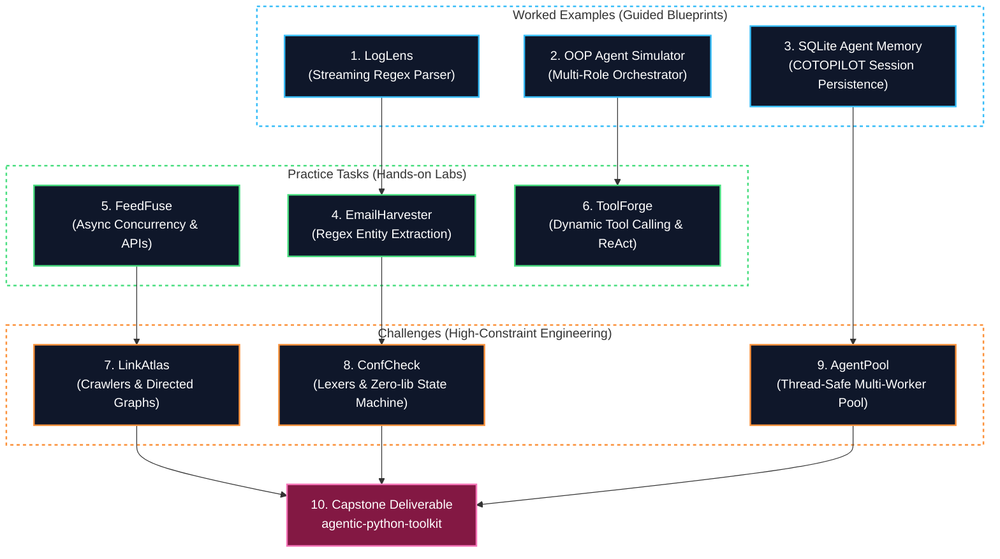

# Python Project-Based Learning Curriculum 🎓
> **Target Audience:** Anyone who has learned basic Python syntax (variables, loops, functions, lists/dictionaries) and wants to become a confident, production-grade AI Software Engineer.  
> **Philosophy:** *“Don’t just learn syntax; build real tools that solve real problems.”*

---

## 🗺️ The Complete Milestone 0 Project Landscape

This repository features nine complete, production-grade projects plus a milestone deliverable, spanning streaming text, concurrent networking, object-oriented agent hierarchies, relational database memory, and multi-threaded worker pools:

---

## 1. Project Curriculum Matrix

| # | Project | Category | Location | Difficulty | Core Topics Learned | Real-World Utility |
|---|---|---|---|---|---|---|
| **1** | **LogLens** | Worked Example | [`Worked Examples/WE 1 - LogLens`](Worked%20Examples/WE%201%20-%20LogLens) | 🟢 Beginner | Generators (`yield`), Regex Named Groups `(?P<name>)`, Memory-safe file streaming | Parse multi-GB server access logs without freezing RAM. |
| **2** | **OOP Agent Simulator** | Worked Example | [`Worked Examples/WE 2- OOP Agent Simulator`](Worked%20Examples/WE%202-%20OOP%20Agent%20Simulator) | 🟡 Intermediate | Abstract Base Classes (`ABC`), Subprocess code execution sandbox, LLM planning, Verifier retry loops | Coordinates 9 specialist agents to generate games, web apps, and research. |
| **3** | **SQLite Agent Memory** | Worked Example | [`Worked Examples/WE 3- SQLite Agent Memory`](Worked%20Examples/WE%203-%20SQLite%20Agent%20Memory) | 🟡 Intermediate | Relational schema, Foreign key cascades (`PRAGMA foreign_keys = ON`), CLI history browser | Persists multi-agent tasks, messages, and reports across restarts. |
| **4** | **EmailHarvester** | Practice Task | [`Practice Tasks/PT 1 - EmailHarvester`](Practice%20Tasks/PT%201%20-%20EmailHarvester) | 🟢 Beginner | Complex regex patterns, Subdomains, Plus-addressing, Domain grouping, CSV/JSON exporters | Extracts clean contact directories from unstructured communication data. |
| **5** | **FeedFuse** | Practice Task | [`Practice Tasks/PT 2 - FeedFuse`](Practice%20Tasks/PT%202%20-%20FeedFuse) | 🟡 Intermediate | `asyncio`, `httpx.AsyncClient`, Dot-notation JSON mapping, Secret isolation (`${VAR}`), TTL disk caching | Merges multiple slow REST APIs concurrently without blocking. |
| **6** | **ToolForge** | Practice Task | [`Practice Tasks/PT 3 - ToolForge`](Practice%20Tasks/PT%203%20-%20ToolForge) | 🟠 Advanced | Dynamic OOP Tool Hierarchy, XML Tool Calling Protocol, ReAct Loop, Workspace Sandboxing | Powers autonomous agents with tool-calling abilities (Web Search, File I/O, DB query). |
| **7** | **LinkAtlas** | Challenge | [`Challenges/CH 1 - LinkAtlas`](Challenges/CH%201%20-%20LinkAtlas) | 🔴 Pro | Breadth-First Search (BFS), Politeness & `robots.txt`, Directed Graphs, GraphML / DOT / CSV export | Recursively crawls websites, mapping link topologies and auditing broken URLs. |
| **8** | **ConfCheck** | Challenge | [`Challenges/CH 2 - ConfCheck`](Challenges/CH%202%20-%20ConfCheck) | 🟠 Advanced | Compiler Lexing, Line-by-line State Machine, Type Inference, Schema Validation, CI Exit Codes | Lints configuration files with zero external libraries with exact line numbers. |
| **9** | **AgentPool** | Challenge | [`Challenges/CH 3 - AgentPool`](Challenges/CH%203%20-%20AgentPool) | 🔴 Pro | Multi-threaded Worker Pool, `queue.Queue`, Poison Pill termination, SQLite WAL mode + Mutex lock | Executes 20 tasks concurrently across 5 agents with deadlock prevention. |

---

## 2. In-Depth Project Summaries & Direct Guides

### 📗 1. LogLens (Streaming Regex Log Parser)
- 📂 **Directory:** [`Worked Examples/WE 1 - LogLens`](Worked%20Examples/WE%201%20-%20LogLens)
- 📖 **Guide:** [`WE 1 - LogLens/STEP_BY_STEP_GUIDE.md`](Worked%20Examples/WE%201%20-%20LogLens/STEP_BY_STEP_GUIDE.md)
- Demonstrates how to stream and filter 50 GB log files within ~15 MB of RAM using Python generators (`yield`).

### 📘 2. OOP Agent Simulator
- 📂 **Directory:** [`Worked Examples/WE 2- OOP Agent Simulator`](Worked%20Examples/WE%202-%20OOP%20Agent%20Simulator)
- 📖 **Guide:** [`WE 2- OOP Agent Simulator/STEP_BY_STEP_GUIDE.md`](Worked%20Examples/WE%202-%20OOP%20Agent%20Simulator/STEP_BY_STEP_GUIDE.md)
- Uses an Orchestrator to plan goals into tasks, distributes them round-robin to specialist agents (Coder, Researcher, Writer), runs generated code in an isolated subprocess, and handles verifier feedback loops.

### 📙 3. SQLite Agent Memory (COTOPILOT)
- 📂 **Directory:** [`Worked Examples/WE 3- SQLite Agent Memory`](Worked%20Examples/WE%203-%20SQLite%20Agent%20Memory)
- 📖 **Guide:** [`WE 3- SQLite Agent Memory/STEP_BY_STEP_GUIDE.md`](Worked%20Examples/WE%203-%20SQLite%20Agent%20Memory/STEP_BY_STEP_GUIDE.md)
- Complete database persistence engine for multi-agent systems with foreign-key cascade deletions and CLI history inspection.

### 📧 4. EmailHarvester
- 📂 **Directory:** [`Practice Tasks/PT 1 - EmailHarvester`](Practice%20Tasks/PT%201%20-%20EmailHarvester)
- 📖 **Guide:** [`PT 1 - EmailHarvester/STEP_BY_STEP_GUIDE.md`](Practice%20Tasks/PT%201%20-%20EmailHarvester/STEP_BY_STEP_GUIDE.md)
- High-precision regex contact extractor handling subdomains, aliases, frequency counting, and JSON/CSV exports.

### ⚡ 5. FeedFuse
- 📂 **Directory:** [`Practice Tasks/PT 2 - FeedFuse`](Practice%20Tasks/PT%202%20-%20FeedFuse)
- 📖 **Guide:** [`PT 2 - FeedFuse/STEP_BY_STEP_GUIDE.md`](Practice%20Tasks/PT%202%20-%20FeedFuse/STEP_BY_STEP_GUIDE.md)
- Concurrent async API aggregator with dot-notation mapping, connection pooling, and disk TTL caching.

### 🔨 6. ToolForge
- 📂 **Directory:** [`Practice Tasks/PT 3 - ToolForge`](Practice%20Tasks/PT%203%20-%20ToolForge)
- 📖 **Guide:** [`PT 3 - ToolForge/STEP_BY_STEP_GUIDE.md`](Practice%20Tasks/PT%203%20-%20ToolForge/STEP_BY_STEP_GUIDE.md)
- ReAct tool calling framework with dynamic `ToolBox` registry, XML delimiter extraction, and workspace path sandboxing.

### 🕷️ 7. LinkAtlas
- 📂 **Directory:** [`Challenges/CH 1 - LinkAtlas`](Challenges/CH%201%20-%20LinkAtlas)
- 📖 **Guide:** [`CH 1 - LinkAtlas/STEP_BY_STEP_GUIDE.md`](Challenges/CH%201%20-%20LinkAtlas/STEP_BY_STEP_GUIDE.md)
- Recursive polite crawler enforcing `robots.txt` compliance, `Crawl-delay`, BFS depth limits, and directed graph serialization.

### ⚙️ 8. ConfCheck
- 📂 **Directory:** [`Challenges/CH 2 - ConfCheck`](Challenges/CH%202%20-%20ConfCheck)
- 📖 **Guide:** [`CH 2 - ConfCheck/STEP_BY_STEP_GUIDE.md`](Challenges/CH%202%20-%20ConfCheck/STEP_BY_STEP_GUIDE.md)
- Pure-regex INI configuration parser with line-by-line state machines and zero external dependencies.

### 🧵 9. AgentPool
- 📂 **Directory:** [`Challenges/CH 3 - AgentPool`](Challenges/CH%203%20-%20AgentPool)
- 📖 **Guide:** [`CH 3 - AgentPool/STEP_BY_STEP_GUIDE.md`](Challenges/CH%203%20-%20AgentPool/STEP_BY_STEP_GUIDE.md)
- Concurrent thread-safe worker pool executing 20 tasks across 5 agents with poison pill termination and mutex-locked SQLite WAL storage.

---

## 3. Recommended Study Schedule

Follow the "One Task = One Day Minimum" protocol:
1. **Week 1 (Days 1–5):** Complete Chapters C1, C2, and C3. Focus on regex tokens, sockets, HTTP requests, and JSON APIs.
2. **Week 2 (Days 6–10):** Complete Chapters C4, C5, and C6. Build OOP agents, connect relational memory, and visualize graph structures.
3. **Week 3 (Days 11–13):** Build Worked Examples: LogLens (WE1), OOP Agent Sim (WE2), SQLite Memory (WE3).
4. **Week 4 (Days 14–16):** Build Practice Tasks: EmailHarvester (PT1), FeedFuse (PT2), ToolForge (PT3).
5. **Week 5 (Days 17–20):** Solve Challenges: LinkAtlas (CH1), ConfCheck (CH2), AgentPool (CH3), and package the Milestone Deliverable!
