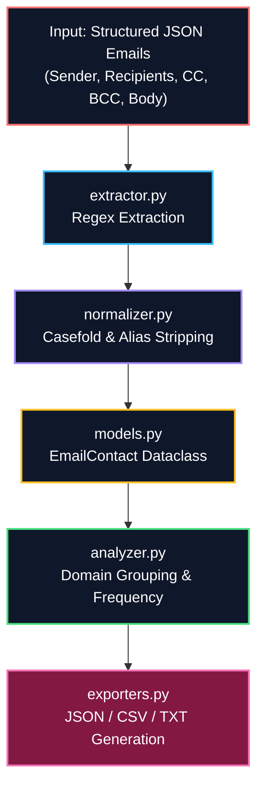

# Step-by-Step Guide: Building EmailHarvester 🛠️

> **Target Directory:** [`PT 1 - EmailHarvester/`](README.md)  
> **Key Objective:** Build a modular CLI email extraction and frequency analysis engine handling edge-case patterns (plus-addressing, subdomains) with multi-format exporters (JSON, CSV, TXT).

---

## 🏗️ Architecture & Component Design



---

## 🪜 Implementation Breakdown

### 1. Robust Regex Pattern (`extractor.py`)
A naive pattern like `\w+@\w+\.\w+` fails on real-world emails. The production regex handles:
- Plus addressing (`user+newsletter@sub.domain.co.uk`)
- Dashes and dots in usernames and domain labels (`first.last-name@deep-mind.google.com`)

```python
import re

EMAIL_REGEX = re.compile(
    r"[a-zA-Z0-9_.+-]+@[a-zA-Z0-9-]+\.[a-zA-Z0-9-.]+"
)

def extract_emails(text: str) -> list[str]:
    if not text:
        return []
    return EMAIL_REGEX.findall(text)
```

### 2. Normalization & Canonicalization (`normalizer.py`)
In email systems, `John.Doe@Gmail.com` and `john.doe@gmail.com` are identical. Furthermore, in Gmail, plus-aliases (`john.doe+test@gmail.com`) map to the primary inbox:

```python
def normalize_email(email: str) -> tuple[str, str, str]:
    """Returns (canonical_email, username, domain)."""
    email = email.strip().lower()
    username, domain = email.split("@", 1)
    
    # Strip plus addressing alias for base username
    base_user = username.split("+", 1)[0]
    canonical = f"{base_user}@{domain}"
    
    return canonical, username, domain
```

### 3. Domain Grouping & Frequency Analysis (`analyzer.py`)
Group contacts by corporate/personal domain and calculate interaction frequency:

```python
from collections import defaultdict

def analyze_contacts(extracted_records: list[dict]) -> dict:
    domain_groups = defaultdict(list)
    frequency_counter = defaultdict(int)

    for item in extracted_records:
        canonical = item["canonical"]
        domain = item["domain"]
        frequency_counter[canonical] += 1
        if canonical not in [c["canonical"] for c in domain_groups[domain]]:
            domain_groups[domain].append(item)

    return {
        "domains": dict(domain_groups),
        "frequencies": dict(frequency_counter)
    }
```

### 4. Multi-Format Exporters (`exporters.py`)
Output clean reports in JSON, CSV, and text tables:

```python
import json, csv

def export_json(data: dict, filepath: str):
    with open(filepath, "w", encoding="utf-8") as f:
        json.dump(data, f, indent=4)

def export_csv(frequencies: dict, filepath: str):
    with open(filepath, "w", newline="", encoding="utf-8") as f:
        writer = csv.writer(f)
        writer.writerow(["Email", "Interaction Count"])
        for email, count in sorted(frequencies.items(), key=lambda x: x[1], reverse=True):
            writer.writerow([email, count])
```

---

## 🧪 Running the Tests & Tool

```bash
# Run unit test suite
pytest tests/

# Execute email harvest on sample mailbox
python main.py --input data/emails.json --output output/
```

---

## 💡 Key Agentic Engineering Insights

1. **Entity Extraction in RAG:** When agents ingest PDF invoices or email threads, extracting entities (emails, phone numbers, tax IDs) using deterministic regex is 100x faster and 100x cheaper than sending full texts to an LLM.
2. **Canonical Deduplication:** Without canonicalization, an agent indexing customer support contacts might treat the same client as multiple different people due to case variations or email aliases.
