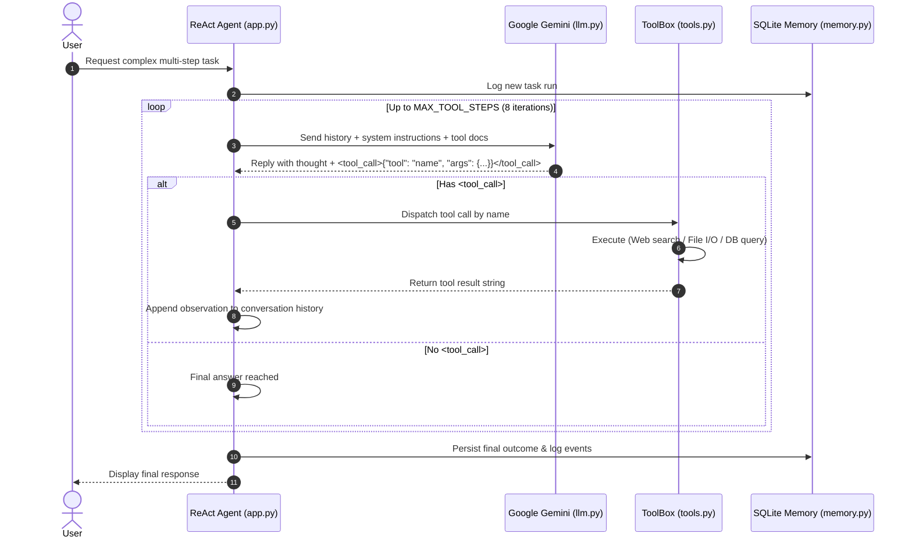

# PT 3: ToolForge — Dynamic Tool Calling & ReAct Agent 🔨⚙️

> **Target Directory:** [`Practice Tasks/PT 3 - ToolForge/`](Readme.md)  
> **Roadmap Alignment:** Day 16 (Commit Target: `m0-pt03-toolhierarchy/`)  
> **Key Architecture:** Dynamic OOP Tool Registry, XML Tool-Calling Protocol, Multi-Step ReAct Loop, Workspace File Operations, and SQLite Memory Persistence.

---

## 🧭 System Overview

**ToolForge** demonstrates how autonomous AI agents interact with the physical and digital world through **Tool Use**. Instead of relying on a high-level black-box framework, ToolForge implements a clean, transparent tool-calling system from scratch.

### Supported Tools:
1. **`web_search`:** Executes live DuckDuckGo web queries and extracts real-time summaries.
2. **`file_op`:** Safely manages workspace files (`create`, `read`, `update`, `delete`, `list`) with raw file content delimiters.
3. **`get_project_details`:** Queries the agent's long-term SQLite database for stored historical project context.

---

## 🏛️ The ReAct Execution Loop (Reasoning + Acting)



---

## 📂 Project Structure

```text
PT 3 - ToolForge/
├── app.py                           <-- Main agent loop & XML tool parser
├── tools.py                         <-- ToolBox registry, tool docs & implementations
├── memory.py                        <-- SQLite persistent memory (tasks, logs, projects)
├── llm.py                           <-- Gemini LLM interface & DuckDuckGo search
├── logger.py                        <-- Structured console and file logging
├── memory.db                        <-- Persistent SQLite database
├── logs/                            <-- Execution trace logs
├── README.md                        <-- You are here (Project Overview)
└── STEP_BY_STEP_GUIDE.md            <-- Step-by-step build tutorial
```

---

## 🏃 Quick Start & Usage

### 1. Requirements
Ensure you have the required dependencies installed:
```bash
pip install google-genai duckduckgo_search python-dotenv
```

Configure `.env`:
```env
API_KEY=your_gemini_api_key
```

### 2. Run the ToolForge Agent
```bash
python app.py
```

Try asking:
- *"Search the web for the latest Python 3.13 release features and create a summary file called python313.md."*
- The agent will think, call `web_search`, receive the results, call `file_op` with `create`, write the file, and return the final confirmation!

👉 For a step-by-step guide on how to build and expand this tool system, read [**STEP_BY_STEP_GUIDE.md**](STEP_BY_STEP_GUIDE.md).
