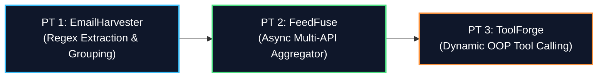

# Practice Tasks Hub (PT 1 – PT 3) 🧪

> **Roadmap Phase:** Days 14–16 (Practice Tasks Phase)  
> **Philosophy:** Focused, standalone software engineering tasks designed to test extraction, concurrency, and dynamic tool invocation without high-level agent frameworks.

---

## 🧭 Overview & Progression

---

## 📊 Practice Tasks Comparison Matrix

| Project | Location | Day | Key Technologies | Real-World Utility |
|---|---|---|---|---|
| **EmailHarvester** | [`PT 1 - EmailHarvester/`](PT%201%20-%20EmailHarvester) | Day 14 | Regex, Domain parsing, Case-insensitive deduplication, Multi-format exports | Extracts and deduplicates contact directories from unstructured communication data. |
| **FeedFuse** | [`PT 2 - FeedFuse/`](PT%202%20-%20FeedFuse) | Day 15 | `asyncio`, `httpx.AsyncClient`, Dot-notation paths, Secret masking (`${TOKEN}`), Disk TTL cache | Concurrently aggregates slow third-party APIs without crashing on individual timeouts. |
| **ToolForge** | [`PT 3 - ToolForge/`](PT%203%20-%20ToolForge) | Day 16 | Dynamic OOP Tool Hierarchy, `ToolBox`, ReAct Execution Loop, Custom XML Tag Parser | Powers autonomous agents with tool-calling abilities (Web Search, File Ops, Project Memory). |

---

## 📂 Sub-Projects Overview

- 📧 [**PT 1: EmailHarvester**](PT%201%20-%20EmailHarvester): Modular regex engine handling complex email variants (subdomains, plus-addressing `user+alias@gmail.com`) and generating structured JSON/CSV/TXT reports.
- ⚡ [**PT 2: FeedFuse**](PT%202%20-%20FeedFuse): Asynchronous REST API integration tool reading YAML task pipelines, executing parallel calls, and merging JSON keys via dot notation.
- 🔨 [**PT 3: ToolForge**](PT%203%20-%20ToolForge): The core engine of agentic tool execution. Provides structured XML tool dispatch (`<tool_call>...<file_content>`), memory persistence, and multi-step reasoning loops.
