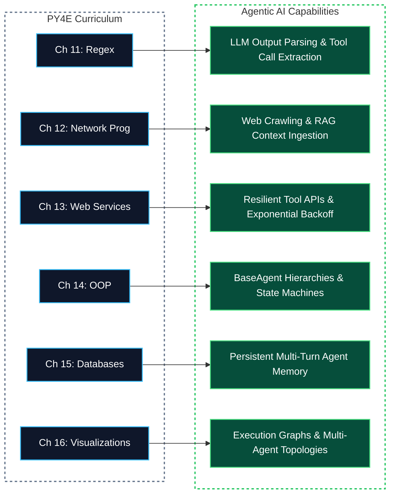

# Milestone 0 (M0): Advanced Python for Agentic AI 🐍⚙️

> **Milestone Duration:** 20 Days (Days 1–20)  
> **Prerequisites:** Basic Python syntax (variables, functions, loops, dictionaries).  
> **Goal:** Transform textbook Python into industrial-grade software engineering skills required to build autonomous agents, resilient tools, streaming pipelines, and persistent database memory.

---

## 🎯 Why Milestone 0 Matters for AI Engineers

Many beginners jump straight into high-level agent frameworks like LangChain, CrewAI, or AutoGen without understanding how Python handles network I/O, regex string sanitization, asynchronous event loops, and database transactions. When an agent hallucinates malformed JSON, locks a SQLite database under concurrent threads, or crashes due to unhandled HTTP 429 rate-limiting, framework-only developers are paralyzed.

Milestone 0 bridges this critical gap. It uses the renowned **Python for Everybody (PY4E)** curriculum (Chapters 11–16) by Dr. Charles Severance and elevates each topic to production Agentic AI standards:



---

## 📅 Milestone 0 Schedule (Days 1–20)

| Phase | Days | Focus | Activity & Deliverable |
|---|---|---|---|
| **Phase 1: Learning** | **Day 1** | Ch 11: Regex Basics | Learn `re.search`, `re.findall`, metacharacters. Extract emails. |
| | **Day 2** | Ch 11: Regex Advanced | Grouping `()`, greedy vs non-greedy, `re.compile()`. Parse log files. |
| | **Day 3** | Ch 12: Networked Programs | HTTP protocol, low-level sockets, `urllib.request`. Simple URL fetcher. |
| | **Day 4** | Ch 12: Parsing HTML | HTML parsing with `BeautifulSoup4`. Link scraper. |
| | **Day 5** | Ch 13: XML & JSON | XML parsing (`xml.etree`), JSON APIs, schema validation. |
| | **Day 6** | Ch 13: API Security & Rate Limits | API keys, Bearer headers, retry logic with exponential backoff. |
| | **Day 7** | Ch 14: OOP Fundamentals | Classes, encapsulation, inheritance, polymorphism, `BaseAgent`. |
| | **Day 8** | Ch 15: Databases (SQLite/MySQL) | Relational tables, CRUD operations, conversation memory stores. |
| | **Day 9** | Ch 15: SQL Advanced | Multi-table relational queries, `JOIN`s, foreign keys, transactions. |
| | **Day 10** | Ch 16: Data Visualization | Geographic mapping, D3.js force graphs, agent performance charts. |
| **Phase 2: Worked Examples** | **Day 11** | [**WE 1: LogLens**](Worked%20Examples/WE%201%20-%20LogLens) | Production streaming Apache/Nginx log parser with regex & generators. |
| | **Day 12** | [**WE 2: OOP Agent Sim**](Worked%20Examples/WE%202-%20OOP%20Agent%20Simulator) | Multi-role specialist agent simulator (`BaseAgent`, `Coder`, `Writer`). |
| | **Day 13** | [**WE 3: SQLite Memory**](Worked%20Examples/WE%203-%20SQLite%20Agent%20Memory) | COTOPILOT: Multi-agent orchestrator with SQLite session persistence. |
| **Phase 3: Practice Tasks** | **Day 14** | [**PT 1: EmailHarvester**](Practice%20Tasks/PT%201%20-%20EmailHarvester) | Extraction engine handling subdomains, aliases, and frequency analytics. |
| | **Day 15** | [**PT 2: FeedFuse**](Practice%20Tasks/PT%202%20-%20FeedFuse) | Asynchronous multi-API aggregator using `asyncio` and `httpx`. |
| | **Day 16** | [**PT 3: ToolForge**](Practice%20Tasks/PT%203%20-%20ToolForge) | Dynamic OOP Tool Calling hierarchy (`BaseTool`, `ToolRegistry`, ReAct). |
| **Phase 4: Challenges** | **Day 17** | [**CH 1: LinkAtlas**](Challenges/CH%201%20-%20LinkAtlas) | Recursive polite web crawler respecting `robots.txt` & graph exporting. |
| | **Day 18** | [**CH 2: ConfCheck**](Challenges/CH%202%20-%20ConfCheck) | Pure-regex INI configuration parser & schema linter (Zero external libraries). |
| | **Day 19** | [**CH 3: AgentPool**](Challenges/CH%203%20-%20AgentPool) | Thread-safe agent worker pool with `queue.Queue` & concurrent SQLite DB. |
| **Phase 5: Deliverable** | **Day 20** | **Milestone Capstone** | Package `agentic-python-toolkit` with unified docs, tests, and CI/CD. |

---

## 🏗️ Repository Architecture: Two Parallel Learning Tracks

Milestone 0 is structured into two complementary learning tracks:

```text
1- PY4E/
│
├── [TRACK 1: CONCEPTUAL CHAPTERS]
│   ├── C1 # Regular Expressions/       --> Dr. Chuck Regex slides (PDF/DOCX) + practice p1-p13 & capstone
│   ├── C2 # Network Programming/       --> Dr. Chuck HTTP slides (PDF/PPTX) + sockets, urllib, BeautifulSoup
│   ├── C3 # Web Services/              --> Dr. Chuck WebServices slides (PDF/PPTX) + REST & exponential backoff
│   ├── C4 # OOP/                       --> Dr. Chuck OOP slides (PDF/PPTX) + BaseAgent & Gemini execution
│   ├── C5 # Databases/                 --> Dr. Chuck SQL slides (PDF/PPTX) + relational memory & chat agent
│   └── C6 # Data Visualization/        --> Dr. Chuck Viz slides (PDF/PPTX) + Geocoding & PageRank D3 graph
│
└── [TRACK 2: PRODUCTION-GRADE PROJECTS]
    ├── Worked Examples/                --> Full architecture reference implementations
    │   ├── WE 1 - LogLens              --> Generator-based memory-safe streaming parser
    │   ├── WE 2- OOP Agent Simulator   --> LLM-powered multi-role agent simulator
    │   └── WE 3- SQLite Agent Memory   --> COTOPILOT orchestrator with verification & DB
    ├── Practice Tasks/                 --> Hands-on standalone CLI tools
    │   ├── PT 1 - EmailHarvester       --> Regex domain analysis and multi-format exports
    │   ├── PT 2 - FeedFuse             --> Async concurrent API aggregator with disk cache
    │   └── PT 3 - ToolForge            --> ReAct tool-use agent with dynamic registry
    └── Challenges/                     --> Advanced constraints & distributed systems
        ├── CH 1 - LinkAtlas            --> BFS polite crawler & graph serialization
        ├── CH 2 - ConfCheck            --> Lexer/Parser state machine without libraries
        └── CH 3 - AgentPool            --> Thread-safe worker pool & deadlock prevention
```

---

## 🚀 How to Study This Milestone

1. **Start in the Chapters (`C1` to `C6`):**
   - Read the Chapter `README.md` and `Content/Notes.md`.
   - Run and experiment with the code snippets in `Source Code/practice` or `Worked Examples`.
   - Build the chapter's final task or deliverable by following its `STEP_BY_STEP_GUIDE.md`.

2. **Transition to the 3 Outer Folders:**
   - **Worked Examples:** Study how production tools are organized (CLI parsers, modular files, error handling).
   - **Practice Tasks:** Read the project `STEP_BY_STEP_GUIDE.md` and implement the tasks yourself before looking at the solution.
   - **Challenges:** Tackle real-world engineering constraints: zero external dependencies, asynchronous rate-limiting, and multi-threaded synchronization.

3. **Verify Everything with Tests:**
   Most projects in `Worked Examples`, `Practice Tasks`, and `Challenges` include automated test suites powered by `pytest`. Run:
   ```bash
   pytest tests/
   ```

---

## 🔗 Quick Links to Chapter Guides & Dr. Chuck Resources

| Chapter | Topic | Agentic Guide | Dr. Chuck Official Study Slides |
|---|---|---|---|
| **C1** | **Regular Expressions** | [Guide](C1%20%23%20Regular%20Expressions/README.md) | [PDF Slides](C1%20%23%20Regular%20Expressions/Content/By%20Dr.Chuck/1-%20Pythonlearn-11-Regex.pdf) · [DOCX Guide](C1%20%23%20Regular%20Expressions/Content/By%20Dr.Chuck/1-%20Python_Regex_Guide.docx) |
| **C2** | **Network Programming** | [Guide](C2%20%23%20Network%20Programming/README.md) | [PDF Slides](C2%20%23%20Network%20Programming/Content/Dr.%20Chuck/Pythonlearn-12-HTTP.pdf) · [PPTX Deck](C2%20%23%20Network%20Programming/Content/Dr.%20Chuck/Pythonlearn-12-HTTP.pptx) |
| **C3** | **Web Services & APIs** | [Guide](C3%20%23%20Web%20Services/README.md) | [PDF Slides](C3%20%23%20Web%20Services/Content/Dr%20Chuck/Pythonlearn-13-WebServices.pdf) · [PPTX Deck](C3%20%23%20Web%20Services/Content/Dr%20Chuck/Pythonlearn-13-WebServices.pptx) |
| **C4** | **OOP for Agents** | [Guide](C4%20%23%20OOP/README.md) | [PDF Slides](C4%20%23%20OOP/Content/Dr%20Chuck/Pythonlearn-14-Objects.pdf) · [PPTX Deck](C4%20%23%20OOP/Content/Dr%20Chuck/Pythonlearn-14-Objects.pptx) |
| **C5** | **Databases & Memory** | [Guide](C5%20%23%20Databases/README.md) | [PDF Slides](C5%20%23%20Databases/Content/Dr%20Chuck/Pythonlearn-15-Databases.pdf) · [PPTX Deck](C5%20%23%20Databases/Content/Dr%20Chuck/Pythonlearn-15-Databases.pptx) |
| **C6** | **Data Visualization** | [Guide](C6%20%23%20Data%20Visualization/README.md) | [PDF Slides](C6%20%23%20Data%20Visualization/Content/Dr%20Chuck/Pythonlearn-16-Data-Viz.pdf) · [PPTX Deck](C6%20%23%20Data%20Visualization/Content/Dr%20Chuck/Pythonlearn-16-Data-Viz.pptx) |

---
*Milestone 0 transforms Python learners into confident software architects ready for GenAI and Agentic AI.*
