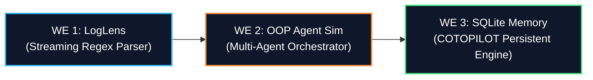

# Worked Examples Hub (WE 1 – WE 3) 🛠️

> **Roadmap Phase:** Days 11–13 (Worked Examples Phase)  
> **Philosophy:** Production-grade blueprints demonstrating end-to-end architectures, clean module separation, type safety, test suites, and robust exception recovery.

---

## 🧭 Overview & Progression

The three Worked Examples take core software engineering concepts and assemble them into full-scale systems:

---

## 📊 Projects Comparison Matrix

| Project | Location | Day | Key Technologies | Real-World Utility |
|---|---|---|---|---|
| **LogLens** | [`WE 1 - LogLens/`](WE%201%20-%20LogLens) | Day 11 | `re.compile()`, Python Generators (`yield`), Dynamic AST AST filtering, Streaming CSV/JSON | Parses multi-GB server logs in ~15MB RAM without memory crashes. |
| **OOP Agent Simulator** | [`WE 2- OOP Agent Simulator/`](WE%202-%20OOP%20Agent%20Simulator) | Day 12 | OOP Hierarchies, `google-genai`, Task Planning, Code Verification Sandbox, Retry Loops | Decomposes goals into subtasks, distributes them to 9 specialist agents, and executes code. |
| **SQLite Agent Memory** | [`WE 3- SQLite Agent Memory/`](WE%203-%20SQLite%20Agent%20Memory) | Day 13 | SQLite Relational Schema, Foreign Key Cascades, CLI History Browser, COTOPILOT Engine | Persists sessions, conversations, and reports across restarts with zero context loss. |

---

## 📂 Directory Contents

- [**WE 1 - LogLens**](WE%201%20-%20LogLens): High-performance log parsing engine with CLI, presets (Nginx, Apache, Syslog), and unit tests.
- [**WE 2- OOP Agent Simulator**](WE%202-%20OOP%20Agent%20Simulator): Complete multi-role agent simulator with LLM planning, code compilation/execution sandbox, and verifier feedback loops.
- [**WE 3- SQLite Agent Memory**](WE%203-%20SQLite%20Agent%20Memory): COTOPILOT production multi-agent task orchestrator with comprehensive SQLite history, cascade deletions, and terminal dashboards.
- **Results/**: Real-world outputs produced by the multi-agent system:
  - `Top-Down Car Racing/`: Research report, game documentation, and complete runnable Python Pygame car racing game.
  - `Whack-a-Mole/`: Pygame arcade game, system plan, research breakdown.
  - `Youtube clone/`: Full HTML/CSS frontend and documentation generated autonomously by 4 agents.
