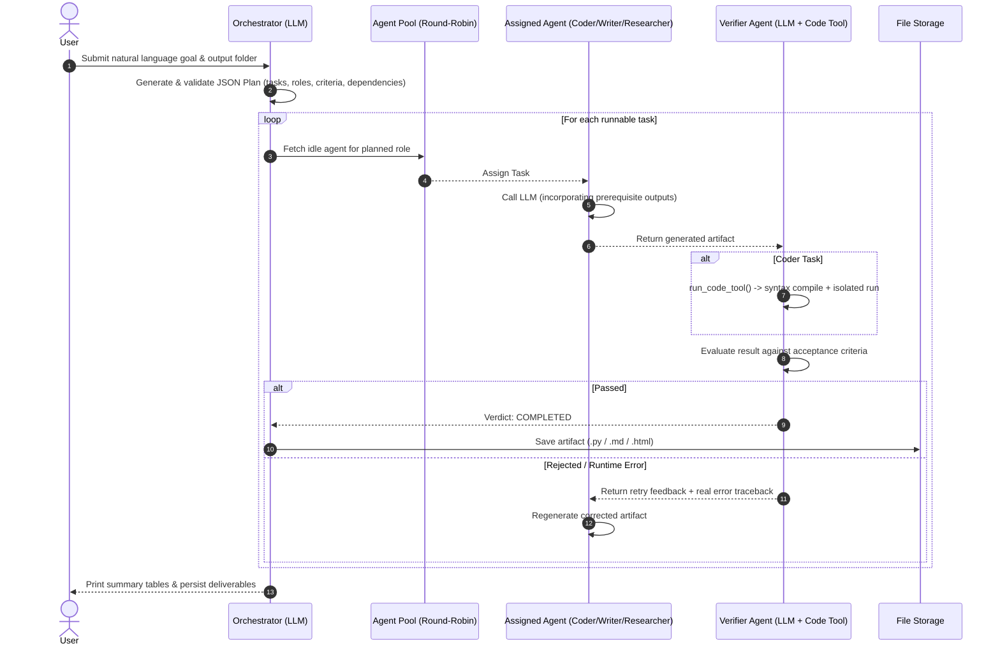

# WE 2: Multi-Agent Task Orchestrator & Simulator 🤖👥

> **Target File:** [`m0-we02 oop-agentsim.py`](m0-we02%20oop-agentsim.py)  
> **Roadmap Alignment:** Day 12 (Commit Target: `m0-we02-oop-agentsim/`)  
> **Key Architecture:** Dynamic LLM Task Planning, Multi-Role Specialist Hierarchy, Round-Robin Dispatch, Sandbox Code Execution Tool, and Automated Verifier Retry Loops.

---

## 🧭 System Overview

`m0-we02 oop-agentsim.py` is a production-grade multi-agent task orchestrator written in clean, modern Python. Given a high-level goal in natural language (e.g. *"Build a Top-Down Car Racing Game"*), the system autonomously:
1. **Plans:** An LLM Orchestrator decomposes the goal into a dependency-aware JSON task graph.
2. **Assigns:** Dispatches subtasks to 9 specialist agents across 3 domains (Research, Coding, Writing).
3. **Executes:** Injects outputs of prerequisite tasks into downstream agent prompts.
4. **Verifies:** A specialized `VerifierAgent` syntax-checks and runs generated Python code in a safe temporary subprocess with timeout protection.
5. **Retries:** If the code crashes or fails acceptance criteria, the verifier sends real execution tracebacks back to the coder for iterative refinement.
6. **Delivers:** Formats output files, saves artifacts to disk, and renders clear ANSI terminal summary tables.

---

## 🏛️ Multi-Agent Interaction Workflow



---

## 👥 The Specialist Roster

| Role | Agents | Focus Area |
|---|---|---|
| **Writer** | Ahmad, Akram, Afzal | Narrative architecture, technical documentation, clear user guides |
| **Researcher** | Ali, Muhammad, Asad | Feasibility research, API discovery, architecture specification |
| **Coder** | Saqib, Bilal, Yasoob | Production-grade, runnable, commented code in Python/C++/HTML |
| **Verifier** | Verifier | Objective quality control, syntax compilation, runtime test execution |
| **Orchestrator** | Orchestrator | Graph planning, dependency scheduling, failure recovery |

---

## 🏃 Quick Start & Usage

### 1. Requirements
- Python 3.12+ (uses `typing.override`)
- Google Gemini API Key

```bash
pip install google-genai python-dotenv
```

Ensure `.env` exists with your key:
```env
API_KEY=your_gemini_api_key
```

### 2. Execution
```bash
python "m0-we02 oop-agentsim.py"
```

Prompt example:
```text
Task: Build an arcade Whack-a-Mole game in Python with sound effects and scoring.
Output folder (absolute path): D:\Notes\Personal\Agentic-AI\1- PY4E\Worked Examples\Results\Whack-a-Mole
```

👉 For a deep-dive tutorial on implementing this system from scratch, see [**STEP_BY_STEP_GUIDE.md**](STEP_BY_STEP_GUIDE.md).
