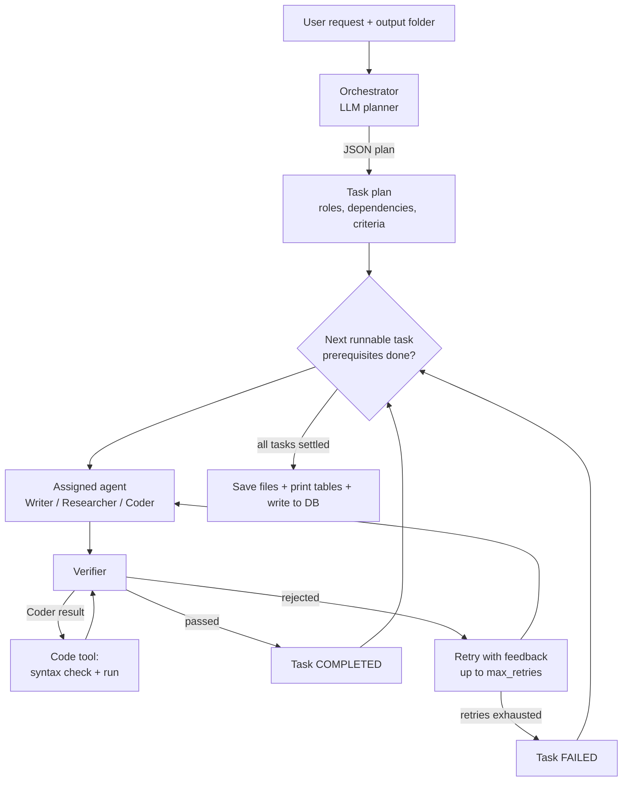
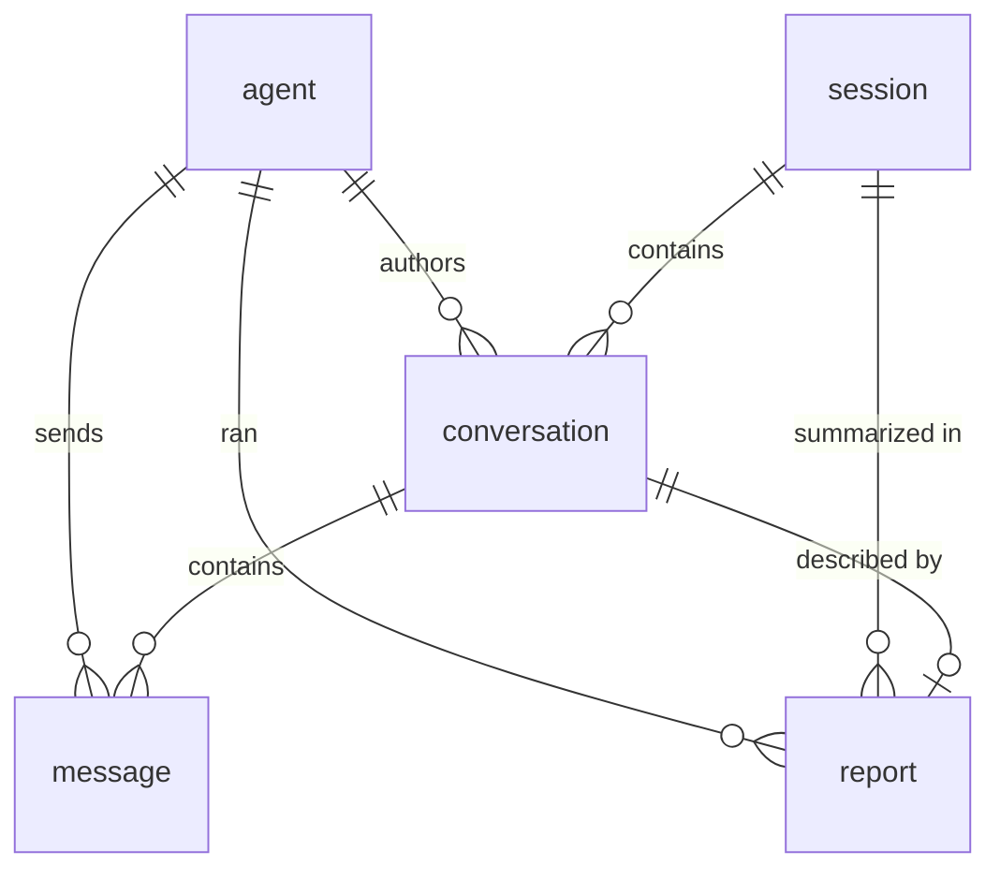

# COTOPILOT

*A multi-agent task orchestrator.*

COTOPILOT is a small multi-agent system in pure Python. You describe a goal in plain English; an **Orchestrator** breaks it into a dependency-aware plan, hands each step to a specialist **agent** (writer, researcher or coder), has a **Verifier** check every result (including actually running generated code), retries failed work with feedback, saves the deliverables to a folder you choose, and records the whole run in a **SQLite database**.

All LLM calls go through Google Gemini (`google-genai`).

---

## Capabilities at a glance

| Capability | What it does |
|---|---|
| **LLM task planning** | The Orchestrator turns a free-form request into a JSON plan: subtasks, assigned role, task IDs, dependencies and acceptance criteria. |
| **Specialist agents** | 9 agents in 3 roles: Writer, Researcher, Coder, each with its own role instructions. |
| **Dependency-aware execution** | Tasks run in dependency order. A task's prerequisites' outputs are passed into its prompt. Failed prerequisites fail their dependents; circular or unknown dependencies are detected. |
| **Round-robin assignment** | Tasks are spread across the idle agents of the matching role. |
| **LLM verifier** | Every result is judged against its acceptance criteria. If the verdict can't be parsed, the task fails (fail closed). |
| **Code execution tool** | For coder results, the verifier syntax-checks the code, then **runs it** (Python) in a temp folder with a timeout, and uses the real stdout/stderr/exit code in its judgement. |
| **Retries with feedback** | A rejected task is retried (default: 2 retries) with the verifier's feedback or the real error traceback appended to the prompt. |
| **File output** | Results are saved to an absolute folder path you provide at runtime. |
| **Console tables** | The run is printed as readable tables, not raw JSON. |
| **Persistent history** | Sessions, conversations, messages and reports are stored in SQLite with foreign-key constraints, and can be queried or deleted from the command line. |

---

## How it works



1. **Plan.** The Orchestrator asks the LLM for a JSON plan and validates it.
2. **Assign.** Each task gets an idle agent of the planned role (round-robin).
3. **Execute.** Tasks run once their prerequisites are `COMPLETED`; prerequisite outputs are injected into the prompt.
4. **Verify.** The Verifier checks the result against the acceptance criteria. Coder output is also executed (see below).
5. **Retry or fail.** Rejected results are retried with feedback; after the retry limit the task is `FAILED`.
6. **Deliver.** Outputs are saved to your folder, summary tables are printed, and everything is stored in the database.

### The agents

| Role | Agents | Responsibility |
|---|---|---|
| Writer | Ahmad, Akram, Afzal | Polished written content |
| Researcher | Ali, Muhammad, Asad | Organized findings, flags uncertainty |
| Coder | Saqib, Bilal, Yasoob | Complete, runnable, commented code |
| Verifier | Verifier | Judges results; runs coder output |
| Orchestrator | Orchestrator | Plans and coordinates |

### The verifier's code tool

For every coder result the verifier:

1. extracts the first fenced code block (a result with no code block fails),
2. **compiles** it without executing, so syntax errors fail immediately,
3. **runs** it in a temporary directory (10 s timeout, stdin closed, Python isolated mode, `API_KEY` removed from its environment),
4. fails the task on a non-zero exit and returns the real traceback to the coder as retry feedback,
5. otherwise passes stdout/stderr/exit code to the LLM verifier as evidence. A timeout is **not** treated as failure, since servers and long loops are legitimate.

Only Python is executed; other languages fall back to the LLM-only check.

> ⚠️ **Security note.** This runs LLM-written code on your machine. It has a timeout and a stripped environment, but it is **not a sandbox**: the code can still read your files and use the network. Don't run it on untrusted prompts outside a container or VM.

---

## Requirements

- Python **3.12+** (uses `typing.override`)
- A Google Gemini API key

```bash
pip install google-genai python-dotenv
```

Create a `.env` file next to the script:

```env
API_KEY=your_gemini_api_key
# optional: where the database is stored (default: agent_system.db)
DB_PATH=agent_system.db
```

The model is set by `MODEL_NAME` near the top of the script.

---

## Usage

### Run a task

```bash
python orchestrator.py
```

You'll be asked for:

```
Task: <your request>
Output folder (absolute path): /home/you/outputs/demo
```

The folder is created if it doesn't exist; relative paths are rejected.

### What you get

**On screen**, five tables: `TASK PLAN`, `EXECUTION RESULTS`, `SUMMARY`, `AGENT ACTIVITY` and `SAVED FILES`.

**In the output folder**, for each completed task:

| File | Contents |
|---|---|
| `T1_writer_Ahmad.md` | The task's full output, headed by the task text |
| `T2_coder_Saqib.py` | The extracted code as a runnable file (extension follows the language) |
| `plan.json` | The task plan |
| `summary.json` | Report and per-task status / verifier feedback |

Failed tasks produce no output file; their reason is in the tables and `summary.json`.

### Browse history

```bash
python orchestrator.py sessions            # list past runs
python orchestrator.py show 3              # conversations + report for session 3
python orchestrator.py messages 12         # every message in conversation 12
python orchestrator.py delete 3            # delete session 3 and everything under it
```

---

## Database

SQLite, standard library only. Foreign keys are enforced on every connection.



| Table | Purpose |
|---|---|
| `agent` | `id` (database key), `name`, `role`. Includes the Orchestrator and Verifier. Stable across runs. |
| `session` | One row per run: start/end timestamps, the user's prompt, the output folder. |
| `conversation` | One per task, authored by the assigned agent, linked to its session. Plus one for the Orchestrator (prompt and plan). |
| `message` | Timestamped events in a conversation: task prompt, agent output, verifier verdict, retry prompt, error, final status. |
| `report` | One row per task holding every field shown in the console tables, plus session and agent counters. |

**Constraint behavior**

- Deleting a **session** cascades to its conversations, messages and reports.
- Deleting a **conversation** cascades to its messages; its report row is kept with `conversation_id` set to `NULL`.
- Deleting an **agent** that has history is **blocked** (`RESTRICT`).

---

## Project structure

Everything lives in one file, organized in sections:

| Section | Contents |
|---|---|
| LLM helpers | `call_llm`, `extract_json` (tolerates code fences and extra prose) |
| Output helpers | folder validation, file naming, code-block extraction |
| Verifier tool | `run_code_tool` |
| Database | `Database` class and SQL schema |
| Domain model | `Task`, `Agent`, `TaskAgent`, `Coder`, `Researcher`, `Writer` |
| `VerifierAgent` | LLM judge with the code tool |
| `Orchestrator` | planning, scheduling, retries, saving, logging |
| Console | `render_table`, `print_outcome`, history commands |

---

## Limitations

- Code execution covers **Python only**, and is not sandboxed (see the security note).
- Generated programs that wait on `input()` will fail, because stdin is closed.
- Tasks run **sequentially**, not in parallel.
- Quality depends on the LLM's plan and the verifier's judgement; the verifier is itself an LLM.
- The script requires `API_KEY` at startup, even for the history commands.

## Ideas for extension

- Run independent tasks in parallel
- Container-based sandbox for code execution
- Support running more languages in the verifier tool
- Resume or re-run a past session from the database