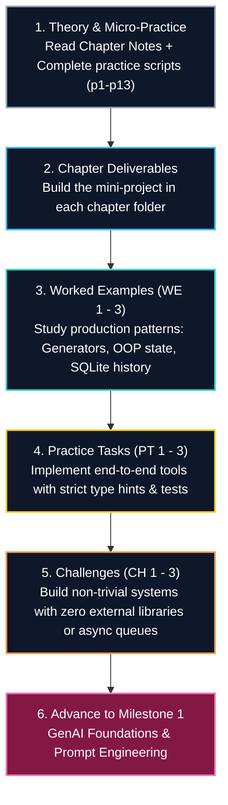

<div align="center">

<h1>🤖 Agentic AI Mastery</h1>

<h3>From Python Basics → Production AI Engineer</h3>

<p><strong>LangGraph &nbsp;·&nbsp; CrewAI &nbsp;·&nbsp; RAG &nbsp;·&nbsp; FastAPI &nbsp;·&nbsp; Azure &nbsp;·&nbsp; Docker &nbsp;·&nbsp; LangSmith</strong></p>

<br/>

[](LICENSE)
[](https://python.org)
[](1-%20PY4E/README.md)
[](Roadmap/Roadmap.md)
[](README.md)

<br/>

[](https://ai.google.dev)
[](https://sqlite.org)
[](1-%20PY4E/Challenges/CH%203%20-%20AgentPool)
[](1-%20PY4E/Practice%20Tasks)
[](https://www.conventionalcommits.org)

<br/>

> *"Don't just learn syntax — build real tools that solve real problems, then deploy autonomous agents that solve them at scale."*

<br/>

[📘 Start M0 — Advanced Python](1-%20PY4E/README.md)&nbsp;&nbsp;•&nbsp;&nbsp;[🗺️ View Full Roadmap](Roadmap/Roadmap.md)&nbsp;&nbsp;•&nbsp;&nbsp;[🏆 Challenges](1-%20PY4E/Challenges/README.md)&nbsp;&nbsp;•&nbsp;&nbsp;[🛠️ Worked Examples](1-%20PY4E/Worked%20Examples/README.md)

</div>

---

## 🧭 Executive Overview & Repository Vision

Traditional software engineering relies on deterministic code execution. **Agentic AI** introduces autonomous systems where Large Language Models (LLMs) act as reasoning engines—capable of planning, decomposing complex goals, selecting and executing external tools, remembering state across sessions, self-reflecting on errors, and collaborating in multi-agent swarms.

To build reliable agents, you cannot treat LLMs as black boxes. You need rigorous software engineering foundations:
1. **Streaming & Text Processing:** Parsing unstructured model outputs, regex sanitization, and structured extraction.
2. **Network Programming & APIs:** Asynchronous HTTP/Sockets, resilient API consumption with exponential backoff and rate-limiting.
3. **Object-Oriented Design (OOP):** Abstract base classes, polymorphic tools, stateful agent lifecycle management.
4. **Data Persistence:** Relational schemas, conversation memory stores, vector databases, and multi-tenant isolation.
5. **Production Orchestration:** Multi-agent coordination (LangGraph, CrewAI, AutoGen), containerization (Docker), observability (LangSmith), and cloud deployment (Azure).

This repository is organized into **9 Milestones (M0 to M8)**. Currently, the repository features the comprehensive completion of **Milestone 0 (Advanced Python Foundations)**, with a standardized roadmap and architectural foundation for the subsequent milestones.

---

## 🗺️ Master Curriculum Roadmap (M0 — M8)

```mermaid
flowchart LR
    M0["M0: Advanced Python\n(PY4E Ch11-16)"] --> M1["M1: GenAI Foundations\n(Microsoft 21 Lessons)"]
    M1 --> M2["M2: Agentic AI Basics\n+ FastAPI"]
    M2 --> M3["M3: MS AI Agents\n+ LangGraph"]
    M3 --> M4["M4: CrewAI +\nHuggingFace Agents"]
    M4 --> M5["M5: RAG +\nVector Databases"]
    M5 --> M6["M6: Advanced Multi-Agent\n+ Azure"]
    M6 --> M7["M7: Orchestration,\nDocker + LangSmith"]
    M7 --> M8["M8: Capstone\nPortfolio Projects"]

    style M0 fill:#0f172a,stroke:#38bdf8,stroke-width:2px,color:#ffffff
    style M1 fill:#0f172a,stroke:#c084fc,stroke-width:2px,color:#ffffff
    style M2 fill:#0f172a,stroke:#4ade80,stroke-width:2px,color:#ffffff
    style M3 fill:#0f172a,stroke:#fb923c,stroke-width:2px,color:#ffffff
    style M4 fill:#0f172a,stroke:#f472b6,stroke-width:2px,color:#ffffff
    style M5 fill:#0f172a,stroke:#2dd4bf,stroke-width:2px,color:#ffffff
    style M6 fill:#0f172a,stroke:#818cf8,stroke-width:2px,color:#ffffff
    style M7 fill:#0f172a,stroke:#facc15,stroke-width:2px,color:#ffffff
    style M8 fill:#831843,stroke:#fb7185,stroke-width:2px,color:#ffffff
```



### Milestone Summary Matrix

| Milestone | Focus Domain | Duration | Key Technologies & Frameworks | Culminating Deliverable |
|---|---|---|---|---|
| [**M0**](1-%20PY4E/README.md) | **Advanced Python & Software Engineering** | 20 Days | Regex, Sockets, HTTP, REST, OOP, SQLite/MySQL, D3/Graphs | `agentic-python-toolkit` |
| **M1** | **GenAI Foundations (Microsoft 21 Lessons)** | 95 Days | Prompt Engineering, Embeddings, Tokenization, Semantic Kernel, 4-Day Mastery Loop | `genai-foundation-toolkit` |
| **M2** | **Agentic Basics & FastAPI Backend** | 21 Days | ReAct Pattern, Tool Use, Async IO, Pydantic, FastAPI, SSE | `agentic-fastapi-starter` |
| **M3** | **Microsoft AI Agents & LangGraph** | 24 Days | State Graphs, Human-in-the-Loop, AutoGen Duo, Supervisor | `langgraph-agent-suite` |
| **M4** | **CrewAI & HuggingFace Agents** | 22 Days | Role-Playing Agents, smolagents, LlamaIndex, HF Spaces | `multi-framework-agent-suite` |
| **M5** | **RAG & Vector Databases** | 21 Days | Chunking, Hybrid Search, Dense/Sparse, Pinecone, RAGAS | `production-rag-system` |
| **M6** | **Advanced Multi-Agent & Azure Cloud** | 27 Days | Azure OpenAI, Prompt Flow, AG2 Debates, Bicep, CI/CD | `azure-agent-platform` |
| **M7** | **Orchestration, Docker & LangSmith** | 27 Days | Docker Compose, LangSmith Tracing, Prometheus, GitOps | `production-agent-platform` |
| **M8** | **Capstone Portfolio Projects** | 36 Days | 3 End-to-End Live Deployed Systems, Articles, Video Demos | 3 Production Portfolios |
| **Total** | **End-to-End Autonomous AI Engineer** | **293 Days** | **LangGraph · CrewAI · RAG · FastAPI · Azure · Docker · LangSmith** | **3 Live Deployed Portfolios** |

---

## 📂 Repository Directory Structure

```text
d:/Notes/Personal/Agentic-AI/
├── 1- PY4E/                           <-- Milestone 0: Advanced Python Curriculum
│   ├── C1 # Regular Expressions/      <-- Chapter 1: Regex & Pattern Matching
│   ├── C2 # Network Programming/      <-- Chapter 2: Sockets, HTTP & Web Scraping
│   ├── C3 # Web Services/             <-- Chapter 3: XML, JSON & Resilient APIs
│   ├── C4 # OOP/                      <-- Chapter 4: Object-Oriented Agent Design
│   ├── C5 # Databases/                <-- Chapter 5: Relational Memory & CRUD
│   ├── C6 # Data Visualization/       <-- Chapter 6: Network Graphs & Geolocation
│   │
│   ├── Worked Examples/               <-- Production-Grade Guided Reference Projects
│   │   ├── WE 1 - LogLens/            <-- Streaming Server Log Parser (Regex)
│   │   ├── WE 2- OOP Agent Simulator/ <-- Dynamic Multi-Role Task Agent System
│   │   ├── WE 3- SQLite Agent Memory/ <-- COTOPILOT Multi-Agent Orchestrator
│   │   └── Results/                   <-- Agent-generated games, web apps & docs
│   │
│   ├── Practice Tasks/                <-- Self-Contained Practical Engineering Labs
│   │   ├── PT 1 - EmailHarvester/     <-- Regex Contact & Domain Extraction Engine
│   │   ├── PT 2 - FeedFuse/           <-- Async Multi-API Aggregator & Caching
│   │   └── PT 3 - ToolForge/          <-- Dynamic OOP Tool Calling & ReAct Agent
│   │
│   └── Challenges/                    <-- Rigorous Production Constraints & Systems
│       ├── CH 1 - LinkAtlas/          <-- Polite Web Crawler & Graph Mapper
│       ├── CH 2 - ConfCheck/          <-- Regex INI Parser & Linter (Zero-lib)
│       └── CH 3 - AgentPool/          <-- Thread-Safe Multi-Worker Agent Pool
│
├── Roadmap/                           <-- Full Schedule & Timetable Specifications
│   ├── Roadmap.md                     <-- Detailed task-aligned curriculum roadmap (293 working days)
│   └── Roadmap.pdf                    <-- Printable roadmap graphic
└── README.md                          <-- You are here (Repository Master Guide)
```

---

## 🛠️ How to Navigate & Learn from this Repository

Whether you are self-studying or mentoring others, follow this proven learning cadence:



### The Golden Rule: "One Task = One Day Minimum"
- Never rush through multiple projects in a single evening.
- Spend 2 focused hours understanding the architectural choices, writing clean code, handling edge cases, and writing automated tests.
- Maintain a green GitHub commit contribution graph using our standardized commit tags (e.g. `m0-d01-regexbasics.py`, `m0-we01-regex-logparser/`).
- Use Saturday and Sunday as **Buffer Days** for reviewing code, reading architecture papers, and recovering.

---

## 💻 Environment Setup & Prerequisites

### 1. Python Environment
This repository requires **Python 3.11+** (Python 3.12+ recommended for `typing.override`):

```bash
# Clone the repository
git clone https://github.com/shah541-g/Agentic-AI.git
cd Agentic-AI

# Create and activate virtual environment
python -m venv .venv

# On Windows (PowerShell):
.venv\Scripts\Activate.ps1

# On Linux/macOS:
source .venv/bin/activate
```

### 2. Environment Variables (`.env`)
Many advanced agents and tools in this repository use Google Gemini models (`gemini-2.5-flash` or `gemini-3.5-flash-lite`) via `google-genai`. Create a `.env` file at the root or within specific project directories:

```env
API_KEY=your_gemini_api_key_here
DB_PATH=agent_system.db
```

### 3. Core Dependencies
Install the required base libraries:

```bash
pip install google-genai python-dotenv httpx pydantic beautifulsoup4
```

Individual sub-projects have their own `pyproject.toml` or `requirements.txt` for isolated testing.

---

## 📑 Direct Directory Quick Links

- 📘 [**Milestone 0 Overview & PY4E Curriculum**](1-%20PY4E/README.md)
- 🔍 [**Chapter 1: Regular Expressions**](1-%20PY4E/C1%20%23%20Regular%20Expressions/README.md)
- 🌐 [**Chapter 2: Network Programming**](1-%20PY4E/C2%20%23%20Network%20Programming/README.md)
- ⚡ [**Chapter 3: Web Services & APIs**](1-%20PY4E/C3%20%23%20Web%20Services/README.md)
- 🧱 [**Chapter 4: Object-Oriented Programming (OOP)**](1-%20PY4E/C4%20%23%20OOP/README.md)
- 🗄️ [**Chapter 5: Relational Databases & SQL**](1-%20PY4E/C5%20%23%20Databases/README.md)
- 📊 [**Chapter 6: Data Visualization & Graphs**](1-%20PY4E/C6%20%23%20Data%20Visualization/README.md)
- 🛠️ [**Worked Examples Hub**](1-%20PY4E/Worked%20Examples/README.md)
- 🧪 [**Practice Tasks Hub**](1-%20PY4E/Practice%20Tasks/README.md)
- 🏆 [**Challenges Hub**](1-%20PY4E/Challenges/README.md)
- 📅 [**Master Roadmap Schedule**](Roadmap/Roadmap.md)

---

<div align="center">

**Built with ❤️ for engineers aiming to master the frontiers of Autonomous AI Systems.**

[](https://github.com/shah541-g/Agentic-AI)
[](https://github.com/shah541-g/Agentic-AI/fork)

*Task-Aligned Roadmap &nbsp;·&nbsp; 9 Milestones &nbsp;·&nbsp; 293 Working Days &nbsp;·&nbsp; 2 hrs/day (Mon–Fri)*

</div>
